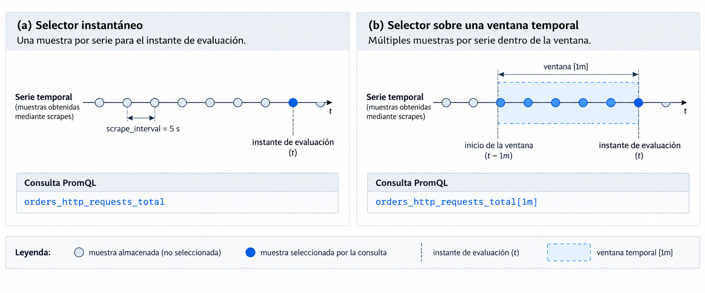
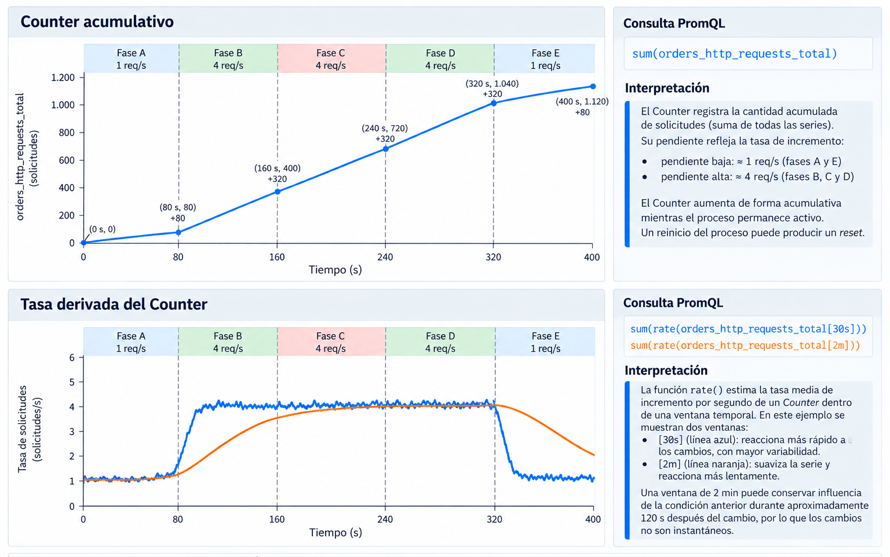
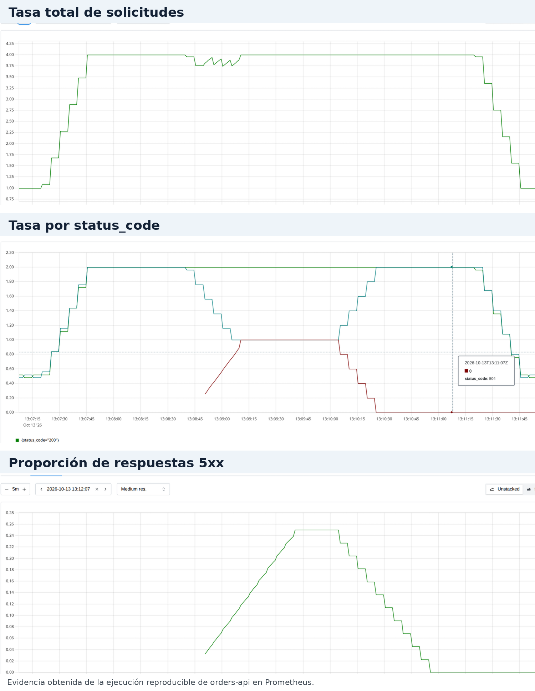
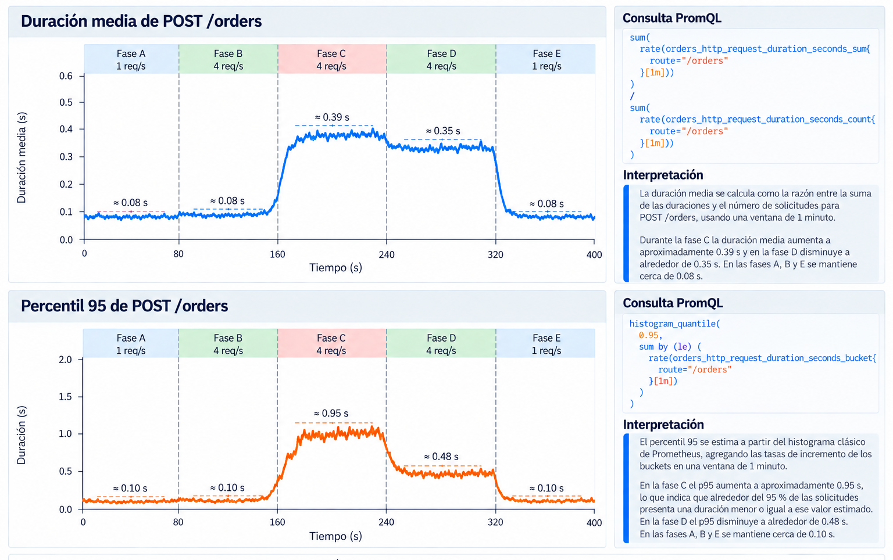

<!--
Requiere en MkDocs Material:
- admonition
- attr_list
- md_in_html
- pymdownx.details
- pymdownx.superfences
- pymdownx.tabbed:
    alternate_style: true
-->

# 3.4 PromQL y análisis de series temporales

## Objetivos de aprendizaje

Al finalizar la sesión se espera que el estudiante pueda:

- formular selectores PromQL mediante nombres de métricas, labels y label matchers;
- distinguir `instant vector`, `range vector`, instant query y range query;
- obtener tasas e incrementos a partir de Counters mediante `rate()` e `increase()`;
- seleccionar una ventana temporal de acuerdo con la resolución requerida para el análisis;
- agregar y agrupar series mediante `sum`, `by` y `without`;
- construir proporciones a partir de tasas, como la proporción de respuestas 5xx;
- calcular la duración media a partir de `_sum` y `_count`;
- estimar cuantiles de un Histogram clásico mediante `histogram_quantile()`;
- interpretar los resultados considerando labels, ventana temporal, unidad y límites de la evidencia disponible.

!!! question "Pregunta central"

    **¿Cómo transformar las series temporales almacenadas por Prometheus en evidencia cuantitativa para caracterizar la actividad, los errores y la duración de un servicio?**


Prometheus conserva muestras de las métricas recolectadas como series temporales. PromQL, *Prometheus Query Language*, permite seleccionar esas series y aplicar transformaciones temporales, agregaciones y operaciones aritméticas para obtener magnitudes útiles para el análisis operacional.

El material utiliza las métricas producidas por `orders-api` en la sesión 3.3.

!!! info "Conceptos retomados de 3.3"
    - **Muestra:** valor observado para una serie en un instante.
    - **Serie temporal:** secuencia de muestras identificada por un nombre de métrica y un conjunto concreto de labels.
    - **Label:** par nombre-valor que distingue dimensiones de una métrica, por ejemplo `route="/orders"` o `status_code="504"`.
    - **Counter:** instrumento acumulativo cuyo valor aumenta con los eventos registrados y puede reiniciarse junto con el proceso.
    - **Histogram clásico:** instrumento que acumula observaciones mediante buckets, `_sum` y `_count`.
    - **Scrape:** recolección periódica que realiza Prometheus sobre el endpoint de métricas.

## Preparación del entorno

La práctica utiliza la rama `3.4-promql` del repositorio de `orders-api`:

```text
https://github.com/guillermocalderon2021/3.3-Prometheus
```

Preparación:

```bash
git fetch
git switch 3.4-promql

docker compose up --build -d
npm run doctor
```

Prometheus se encuentra disponible en:

```text
http://localhost:9090
```

La configuración utilizada en la práctica establece:

```yaml
global:
  scrape_interval: 5s
```

El escenario de tráfico se ejecuta en otra terminal:

```bash
npm run promql:scenario
```

La ejecución completa dura aproximadamente 6 minutos y 40 segundos. El generador utiliza fases deterministas con cambios de tasa, errores y duración de las solicitudes. La configuración exacta se presenta al final de la actividad para permitir primero el análisis de las series observadas.

---

## 1. Modelo de consulta de Prometheus {#modelo-consulta-prometheus}

PromQL opera sobre series temporales almacenadas por Prometheus. Una consulta determina qué series participan, qué muestras están disponibles para el cálculo y qué operación se aplica sobre ellas.

### 1.1 Selección de series temporales

Un **selector de series** puede contener únicamente el nombre de una métrica:

```promql
orders_http_requests_total
```

La expresión selecciona todas las series cuyo nombre sea `orders_http_requests_total`.

En `orders-api`, esta métrica utiliza los labels:

```text
method
route
status_code
```

Por tanto, puede contener series como:

```text
orders_http_requests_total{
  method="POST",
  route="/orders",
  status_code="201"
}

orders_http_requests_total{
  method="POST",
  route="/orders",
  status_code="504"
}

orders_http_requests_total{
  method="GET",
  route="/orders/:id",
  status_code="200"
}
```

Cada combinación distinta de valores de labels identifica una serie temporal.

La selección puede restringirse mediante **label matchers**, expresiones que comparan el valor de un label:

```promql
orders_http_requests_total{
  route="/orders",
  status_code="504"
}
```

La expresión anterior selecciona las series que cumplen ambas condiciones.

| Operador | Significado | Ejemplo |
|---|---|---|
| `=` | igualdad exacta | `status_code="504"` |
| `!=` | valor diferente | `status_code!="201"` |
| `=~` | coincidencia con expresión regular | `status_code=~"5.."` |
| `!~` | exclusión mediante expresión regular | `status_code!~"2.."` |

Por ejemplo:

```promql
orders_http_requests_total{
  status_code=~"5.."
}
```

selecciona las series cuyo código de respuesta pertenece a la familia 5xx.

!!! note "Relación con la instrumentación"
    Los labels definidos durante la instrumentación determinan las dimensiones disponibles para selección y agregación. El valor lógico `route="/orders/:id"` mantiene una serie común para la ruta y evita crear una serie distinta por cada identificador de orden. La **cardinalidad** corresponde al número de series distintas producidas por una métrica.

### 1.2 Instant vectors y range vectors

PromQL utiliza distintos tipos de datos. Los dos tipos principales de esta sesión son `instant vector` y `range vector`.

#### Instant vector

Un **instant vector** contiene una muestra por cada serie seleccionada para un instante de evaluación.

La expresión:

```promql
orders_http_requests_total
```

produce un instant vector.

Conceptualmente:

```text
serie A ──●──●──●──●──●──●
                         ↑
serie B ──●──●──●──●──●──●
                         ↑
serie C ──●──●──●──●──●──●
                         ↑
                 instante evaluado
```

Prometheus utiliza la muestra válida más reciente disponible para cada serie respecto del instante de evaluación.

#### Range vector

Un **range vector** contiene varias muestras de cada serie dentro de una ventana temporal.

La duración se escribe entre corchetes:

```promql
orders_http_requests_total[1m]
```

Con un `scrape_interval` de cinco segundos, una ventana de un minuto puede contener aproximadamente doce muestras por serie:

```text
                     instante de evaluación
                              ↓
serie A   ●  ●  ●  ●  ●  ●  ●  ●  ●  ●  ●  ●
          |-----------------------------------|
                       1 minuto
```

El intervalo se extiende hacia atrás desde el instante de evaluación. Formalmente, el límite izquierdo queda excluido y el derecho incluido.

La expresión:

```promql
orders_http_requests_total[1m]
```

devuelve las muestras de la ventana. Una transformación temporal se incorpora al aplicar una función, por ejemplo:

```promql
rate(
  orders_http_requests_total[1m]
)
```

<figure markdown="span">
  { width="100%" loading="lazy" }
  <figcaption>Figura 1. Selección de muestras mediante un instant vector y un range vector. Ambos selectores se evalúan en el mismo instante; el selector instantáneo aporta una muestra por serie y <code>[1m]</code> aporta las muestras almacenadas dentro de la ventana temporal.</figcaption>
</figure>

### 1.3 Modos de evaluación de una expresión

Los términos **instant query** y **range query** describen cómo se evalúa una expresión PromQL.

Una **instant query** ejecuta la expresión una vez para un instante determinado.

```promql
sum(
  rate(orders_http_requests_total[1m])
)
```

Una **range query** ejecuta repetidamente la misma expresión entre un tiempo inicial y un tiempo final.

```text
13:10:00    expresión → resultado
13:10:05    expresión → resultado
13:10:10    expresión → resultado
13:10:15    expresión → resultado
```

El intervalo entre dos instantes consecutivos de evaluación se denomina **step**.

En la interfaz de Prometheus:

```text
Table → instant query
Graph → range query
```

Si una range query evalúa:

```promql
rate(
  orders_http_requests_total[1m]
)
```

cada punto de la gráfica utiliza su propia ventana de un minuto:

```text
                evaluación 1
        |---------1m---------|
●──●──●──●──●──●──●──●──●──●────────────
                              ↑

                      evaluación 2
             |---------1m---------|
●──●──●──●──●──●──●──●──●──●──●─────────
                                 ↑
```

!!! info "Ventana de cálculo e intervalo visible"
    En `rate(...[1m])`, `[1m]` define la ventana utilizada para calcular cada resultado.

    En la interfaz `Graph`, un rango visual de `10m` define el período de resultados presentado en pantalla. Una gráfica de diez minutos puede estar formada por puntos calculados individualmente con ventanas de un minuto.

---

## 2. Análisis temporal de contadores {#analisis-temporal-contadores}

Un Counter registra una cantidad acumulativa. Para `orders_http_requests_total`, cada incremento representa una solicitud procesada dentro de una combinación concreta de labels.

Un valor acumulado requiere información temporal para caracterizar la intensidad de actividad. Por ejemplo, un valor de `1847` puede corresponder a tráfico concentrado en pocos minutos o acumulado durante varias horas.

### 2.1 Tasa de cambio con `rate()`

`rate()` estima la tasa media de incremento por segundo de un Counter durante una ventana temporal:

```promql
rate(
  orders_http_requests_total[30s]
)
```

La unidad resultante es:

```text
Counter
→ solicitudes

rate(Counter[30s])
→ solicitudes/segundo
```

Considérese la siguiente serie didáctica:

```text
10:00:00   100
10:00:05   112
10:00:10   125
10:00:15   141
10:00:20   153
```

`rate()` utiliza la evolución de varias muestras para estimar el incremento por segundo. También ajusta discontinuidades compatibles con reinicios del Counter y extrapola el cálculo hacia los límites de la ventana.

Un **reset** corresponde a una caída del valor acumulado causada, por ejemplo, por el reinicio del proceso:

```text
10:00:00   980
10:00:05   990
10:00:10     3
10:00:15    12
```

La tasa debe calcularse sobre cada serie antes de cualquier agregación para conservar la detección de resets.

#### Tasa total del servicio

La consulta:

```promql
rate(
  orders_http_requests_total[30s]
)
```

produce una tasa por serie. La tasa total se obtiene mediante:

```promql
sum(
  rate(orders_http_requests_total[30s])
)
```

En la ejecución validada del escenario se observaron aproximadamente:

| Fase | Tasa total |
|---|---:|
| A | 1 req/s |
| B | 4 req/s |
| C | 4 req/s |
| D | 4 req/s |
| E | 1 req/s |

Las transiciones contienen pequeñas variaciones asociadas con los instantes de scrape y con la ventana utilizada por `rate()`.

### 2.2 Incremento durante una ventana con `increase()`

`increase()` estima el incremento acumulado durante la ventana:

```promql
increase(
  orders_http_requests_total[1m]
)
```

| Expresión | Magnitud | Unidad |
|---|---|---|
| `rate(counter[1m])` | tasa media estimada | eventos/s |
| `increase(counter[1m])` | incremento estimado | eventos |

Para el total del servicio:

```promql
sum(
  increase(orders_http_requests_total[1m])
)
```

Durante una fase estable de 1 req/s, el incremento de un minuto se aproxima a 60 solicitudes. Durante una fase estable de 4 req/s se aproxima a 240 solicitudes.

`increase()` utiliza el mismo tratamiento de resets y extrapolación temporal aplicado al Counter. Por esta razón, el resultado puede ser fraccionario aunque los incrementos individuales del Counter sean enteros.

### 2.3 Longitud de la ventana temporal

Considérense dos consultas sobre la misma métrica:

```promql
sum(
  rate(orders_http_requests_total[30s])
)
```

```promql
sum(
  rate(orders_http_requests_total[2m])
)
```

Con un scrape cada cinco segundos, `[30s]` utiliza aproximadamente seis intervalos de scrape. `[2m]` incorpora una historia temporal más extensa.

Durante una transición entre fases, la ventana puede contener muestras asociadas con dos condiciones:

```text
fase B                  fase C
──────────────┬────────────────────────
              ↑
        cambio de condición

       |------------[1m]-------------|
──────────────┬────────────────────────
              ↑
        cambio de condición
```

Una ventana corta reduce la cantidad de historia incluida en cada cálculo y responde antes a cambios recientes. Una ventana larga conserva durante más tiempo muestras anteriores y produce una serie con menor variación de corto plazo.

`rate()` requiere al menos dos muestras dentro de la ventana. Una ventana muy cercana al intervalo de scrape aumenta el riesgo de disponer de evidencia insuficiente para el cálculo.

<figure markdown="span">
  { width="100%" loading="lazy" }
  <figcaption>Figura 2. Relación entre un Counter acumulativo y la tasa derivada mediante <code>rate()</code>. La representación utiliza la configuración determinista del escenario para comparar una ventana de 30 s con una ventana de 2 min.</figcaption>
</figure>

---

## 3. Agregación y composición de series {#agregacion-composicion-series}

Las consultas anteriores producen resultados por cada combinación de labels. Las operaciones de agregación permiten combinar series y conservar únicamente las dimensiones necesarias para la pregunta analítica.

En este material, una **dimensión** corresponde a un label utilizado para distinguir grupos de series, por ejemplo `route` o `status_code`.

### 3.1 Agregación con `sum` y agrupamiento con `by`

La tasa total del servicio se obtiene con:

```promql
sum(
  rate(orders_http_requests_total[30s])
)
```

`sum` agrega todos los elementos del instant vector producido por `rate()`.

Para conservar una dimensión:

```promql
sum by (status_code) (
  rate(orders_http_requests_total[30s])
)
```

El resultado contiene una serie por valor de `status_code`.

Durante la fase C del escenario se observaron aproximadamente:

```text
status_code="200" → 2 req/s
status_code="201" → 1 req/s
status_code="504" → 1 req/s
```

También puede conservarse la ruta:

```promql
sum by (route) (
  rate(orders_http_requests_total[30s])
)
```

En las fases de 4 req/s, el generador produce aproximadamente:

```text
route="/orders"     → 2 req/s
route="/orders/:id" → 2 req/s
```

#### Agrupamiento con `without`

`without` especifica las dimensiones que deben eliminarse durante la agregación y conserva las restantes:

```promql
sum without (method, route) (
  rate(orders_http_requests_total[30s])
)
```

El resultado conserva `status_code` y cualquier otro label presente que no haya sido incluido en `without`.

En consultas donde se desea un conjunto explícito y pequeño de dimensiones, `by(...)` suele facilitar la lectura del resultado.

### 3.2 Proporción de respuestas 5xx

La proporción de respuestas 5xx puede definirse como:

\[
\text{proporción 5xx}
=
\frac{\text{tasa de respuestas 5xx}}
     {\text{tasa total de respuestas}}
\]

La expresión correspondiente es:

```promql
sum(
  rate(
    orders_http_requests_total{
      status_code=~"5.."
    }[1m]
  )
)
/
sum(
  rate(
    orders_http_requests_total[1m]
  )
)
```

El numerador calcula la tasa agregada de respuestas 5xx. El denominador calcula la tasa agregada de todas las solicitudes.

Durante la fase C del escenario, la proporción observada se estabilizó aproximadamente en:

```text
0.25
```

La magnitud es adimensional:

```text
0.25 = 25 %
```

Para expresar directamente el porcentaje:

```promql
100 *
(
  sum(
    rate(
      orders_http_requests_total{
        status_code=~"5.."
      }[1m]
    )
  )
  /
  sum(
    rate(orders_http_requests_total[1m])
  )
)
```

Al finalizar la fase C, la proporción tarda en regresar a cero porque la ventana `[1m]` continúa incluyendo muestras correspondientes al período en que el Counter de `504` estaba aumentando.

<figure markdown="span">
  { width="100%" loading="lazy" }
  <figcaption>Figura 3. Actividad y errores observados durante la ejecución reproducible de <code>orders-api</code>. Se muestran la tasa total, la tasa agrupada por código de respuesta y la proporción de respuestas 5xx obtenidas en Prometheus.</figcaption>
</figure>

---

## 4. Distribuciones de duración y estimación de cuantiles {#distribuciones-cuantiles}

`orders_http_request_duration_seconds` es un Histogram clásico. Para cada combinación de labels se exponen series `_bucket`, `_sum` y `_count`.

En esta práctica, los límites configurados son:

```text
0.05
0.10
0.25
0.50
1.00
2.00
+Inf
```

`_sum` acumula la suma de las duraciones observadas. `_count` acumula el número de observaciones. Cada serie `_bucket{le="..."}` acumula el número de observaciones menores o iguales que su límite `le`.

### 4.1 Duración media

La duración media de `POST /orders` dentro de una ventana se obtiene dividiendo la tasa de crecimiento de `_sum` entre la tasa de crecimiento de `_count`:

```promql
sum(
  rate(
    orders_http_request_duration_seconds_sum{
      route="/orders"
    }[1m]
  )
)
/
sum(
  rate(
    orders_http_request_duration_seconds_count{
      route="/orders"
    }[1m]
  )
)
```

Las unidades son:

```text
rate(_sum)
→ segundos/segundo

rate(_count)
→ observaciones/segundo
```

Por tanto:

```text
(segundos/segundo) / (observaciones/segundo)
→ segundos/observación
```

En la ejecución validada se observaron aproximadamente:

| Fase | Duración media de `POST /orders` |
|---|---:|
| A | 0.08 s |
| B | 0.08 s |
| C | 0.39 s |
| D | 0.35 s |
| E | 0.08 s |

Durante la fase C se alternan solicitudes `normal` y `payment-timeout`:

```text
normal            ≈ 0.08 s
payment-timeout   ≈ 0.70 s
```

La media nominal para una mezcla 50/50 es:

\[
\frac{0.08 + 0.70}{2} \approx 0.39\text{ s}
\]

El valor observado es coherente con la configuración del escenario.

### 4.2 Distribución representada por los buckets

Una observación de:

```text
0.35 s
```

incrementa los buckets cuyos límites contienen ese valor:

```text
le="0.5"
le="1"
le="2"
le="+Inf"
```

Los buckets conservan conteos acumulativos. Las observaciones individuales se descartan después de actualizar esos conteos, `_sum` y `_count`.

Dos distribuciones distintas pueden producir los mismos conteos de buckets. La resolución disponible para análisis posteriores depende de los límites elegidos durante la instrumentación.

### 4.3 Tasa de observaciones por bucket

La distribución reciente puede analizarse calculando la tasa de crecimiento de cada bucket:

```promql
rate(
  orders_http_request_duration_seconds_bucket{
    route="/orders"
  }[1m]
)
```

La expresión mantiene una serie por combinación de labels y por valor de `le`.

Para combinar las series y conservar los límites de los buckets:

```promql
sum by (le) (
  rate(
    orders_http_request_duration_seconds_bucket{
      route="/orders"
    }[1m]
  )
)
```

`le` debe permanecer en el resultado porque identifica la estructura acumulativa utilizada para estimar cuantiles.

### 4.4 Cuantiles y p95

Un **cuantil** es un valor que divide una distribución según una proporción acumulada. El cuantil `0.95`, también denominado **percentil 95** o **p95**, es el valor por debajo del cual se encuentra aproximadamente el 95 % de las observaciones.

Para un Histogram clásico:

```promql
histogram_quantile(
  0.95,
  sum by (le) (
    rate(
      orders_http_request_duration_seconds_bucket{
        route="/orders"
      }[1m]
    )
  )
)
```

`histogram_quantile()` estima el cuantil a partir de los conteos acumulativos de los buckets. Cuando el cuantil se encuentra dentro de un bucket, Prometheus interpola dentro del intervalo correspondiente.

En la ejecución validada se obtuvieron aproximadamente:

| Fase | Media | p95 |
|---|---:|---:|
| A | 0.08 s | 0.10 s |
| B | 0.08 s | 0.10 s |
| C | 0.39 s | 0.95 s |
| D | 0.35 s | 0.48 s |
| E | 0.08 s | 0.10 s |

Durante la fase C, las observaciones cercanas a `0.70 s` se encuentran entre los límites `0.5` y `1.0`. El p95 estimado se aproxima a `0.95 s`.

Durante la fase D, las observaciones cercanas a `0.35 s` se encuentran entre `0.25` y `0.5`. El p95 estimado se aproxima a `0.48 s`.

La distancia entre las duraciones nominales y los cuantiles estimados muestra el efecto de la resolución de los buckets.

#### Interpretación de p95

Un resultado:

```text
p95 ≈ 0.95 s
```

se interpreta como una estimación en la que aproximadamente el 95 % de las observaciones de la distribución considerada se encuentra en valores menores o iguales que `0.95 s`. Aproximadamente el 5 % queda por encima de ese valor estimado.

### 4.5 Comparación entre media y p95

La media resume la suma de todas las duraciones dividida entre el número de observaciones. El p95 localiza un punto alto de la distribución.

En la fase C:

```text
media ≈ 0.39 s
p95   ≈ 0.95 s
```

La mezcla contiene solicitudes rápidas y solicitudes cercanas a `0.70 s`.

En la fase D:

```text
media ≈ 0.35 s
p95   ≈ 0.48 s
```

Las solicitudes presentan una duración más homogénea. El valor de p95 continúa condicionado por los límites del Histogram.

<figure markdown="span">
  { width="100%" loading="lazy" }
  <figcaption>Figura 4. Duración media y p95 de <code>POST /orders</code> durante el escenario experimental. Los valores aproximados proceden de la ejecución utilizada para validar el material; el p95 se estima a partir de los buckets del Histogram clásico.</figcaption>
</figure>


---

## 5. Análisis integrado de `orders-api` {#analisis-integrado-orders-api}

La actividad utiliza las series almacenadas durante una ejecución del escenario y se realiza desde `Table` y `Graph` en Prometheus.

### 5.1 Procedimiento

Ejecute:

```bash
npm run promql:scenario
```

Configure un rango visual suficiente para incluir la ejecución completa. Un intervalo de diez minutos permite observar las cinco fases.

Resuelva las consultas antes de revisar la configuración detallada del escenario.

### 5.2 Actividad

1. Determine la tasa total de solicitudes e identifique los intervalos de menor y mayor actividad.
2. Obtenga la tasa agrupada por `status_code` e identifique el intervalo en el que aparecen respuestas `504`.
3. Calcule la proporción de respuestas 5xx respecto del tráfico total.
4. Compare `rate(...[30s])` con `rate(...[2m])` y describa el efecto de la longitud de la ventana durante las transiciones.
5. Calcule la duración media de `POST /orders`.
6. Calcule el p95 de `POST /orders` mediante `histogram_quantile()`.
7. Compare media y p95 durante los intervalos con mayor duración.
8. Indique qué mecanismos técnicos podrían ser compatibles con el aumento de duración y qué evidencia adicional sería necesaria para discriminar entre ellos.

??? example "Consultas de referencia"
    **Tasa total**

    ```promql
    sum(
      rate(orders_http_requests_total[30s])
    )
    ```

    **Tasa por código de respuesta**

    ```promql
    sum by (status_code) (
      rate(orders_http_requests_total[30s])
    )
    ```

    **Proporción de respuestas 5xx**

    ```promql
    sum(
      rate(
        orders_http_requests_total{
          status_code=~"5.."
        }[1m]
      )
    )
    /
    sum(
      rate(orders_http_requests_total[1m])
    )
    ```

    **Duración media de `POST /orders`**

    ```promql
    sum(
      rate(
        orders_http_request_duration_seconds_sum{
          route="/orders"
        }[1m]
      )
    )
    /
    sum(
      rate(
        orders_http_request_duration_seconds_count{
          route="/orders"
        }[1m]
      )
    )
    ```

    **p95 de `POST /orders`**

    ```promql
    histogram_quantile(
      0.95,
      sum by (le) (
        rate(
          orders_http_request_duration_seconds_bucket{
            route="/orders"
          }[1m]
        )
      )
    )
    ```

??? info "Configuración reproducible del escenario"
    El generador ejecuta cinco fases de 80 segundos.

    | Fase | Tasa total programada | Comportamiento de `POST /orders` |
    |---|---:|---|
    | A | 1 req/s | `normal` |
    | B | 4 req/s | `normal` |
    | C | 4 req/s | alterna `normal` y `payment-timeout` |
    | D | 4 req/s | `slow` |
    | E | 1 req/s | `normal` |

    En las fases de 4 req/s se generan aproximadamente 2 solicitudes POST y 2 solicitudes GET por segundo. Durante la fase C, una de las dos solicitudes POST por segundo utiliza `payment-timeout`, por lo que la proporción programada de respuestas 5xx respecto del tráfico total es aproximadamente 0.25.

??? info "Resultados de la ejecución utilizada para validar el material"
    Los valores siguientes son aproximados y corresponden a una ejecución reproducible del escenario.

    | Fase | Tasa total | Proporción 5xx | Media POST | p95 POST |
    |---|---:|---:|---:|---:|
    | A | ≈ 1 req/s | ≈ 0 | ≈ 0.08 s | ≈ 0.10 s |
    | B | ≈ 4 req/s | ≈ 0 | ≈ 0.08 s | ≈ 0.10 s |
    | C | ≈ 4 req/s | ≈ 0.25 | ≈ 0.39 s | ≈ 0.95 s |
    | D | ≈ 4 req/s | ≈ 0 | ≈ 0.35 s | ≈ 0.48 s |
    | E | ≈ 1 req/s | ≈ 0 | ≈ 0.08 s | ≈ 0.10 s |

    Las transiciones observadas son graduales cuando se utilizan ventanas como `[1m]`, porque cada evaluación puede incluir muestras anteriores y posteriores al cambio de fase.

### 5.3 Alcance de la evidencia

Las consultas construidas en esta sesión permiten caracterizar:

```text
tasa de actividad
distribución por código de respuesta
proporción de respuestas 5xx
duración media
p95
evolución temporal de estas magnitudes
```

La atribución de una causa técnica requiere evidencia adicional. Un aumento de duración puede ser compatible con presión de CPU, memoria, I/O, red, espera en una dependencia externa, bloqueo interno u otros mecanismos. La investigación causal requiere seleccionar señales que permitan distinguir entre esas hipótesis.

---

## Síntesis {#sintesis}

Una consulta PromQL puede analizarse mediante cuatro preguntas:

| Elemento | Pregunta de interpretación |
|---|---|
| Series seleccionadas | ¿Qué población representa la consulta? |
| Ventana temporal | ¿Qué muestras participan en cada cálculo? |
| Operación | ¿Qué transformación se aplica? |
| Magnitud resultante | ¿Qué unidad o significado tiene el resultado? |

Las principales transformaciones utilizadas en esta sesión son:

```text
selector
→ selecciona series

range vector
→ aporta muestras de una ventana

rate()
→ estima una tasa por segundo para Counters

increase()
→ estima el incremento durante una ventana

sum / by / without
→ agregan series y controlan las dimensiones conservadas

operadores aritméticos
→ permiten construir proporciones

histogram_quantile()
→ estima cuantiles a partir de los buckets
```

El diseño de instrumentación condiciona el análisis posterior. Los labels determinan las dimensiones disponibles para selección y agregación; los límites de los buckets determinan la resolución disponible para estimar cuantiles.

---

## Referencias {#referencias}

- Prometheus. [Querying basics](https://prometheus.io/docs/prometheus/latest/querying/basics/).
- Prometheus. [Query functions](https://prometheus.io/docs/prometheus/latest/querying/functions/).
- Prometheus. [Operators](https://prometheus.io/docs/prometheus/latest/querying/operators/).
- Prometheus. [Histograms and summaries](https://prometheus.io/docs/practices/histograms/).
- Prometheus. [Metric types](https://prometheus.io/docs/concepts/metric_types/).
