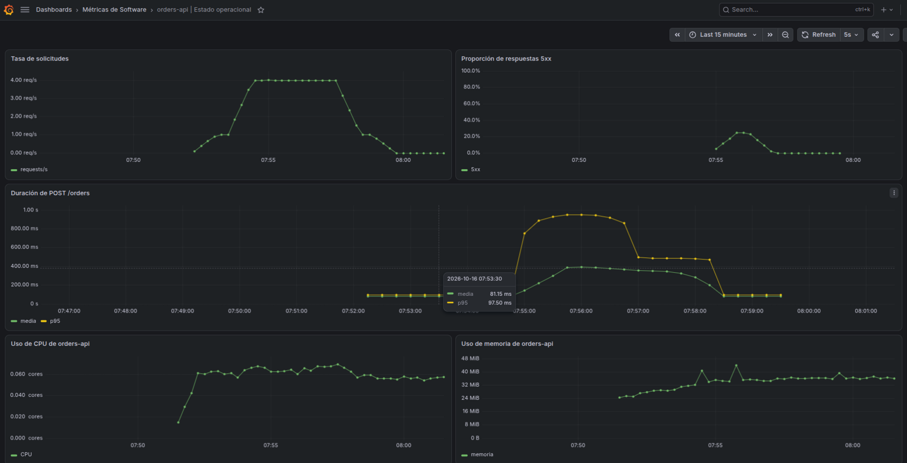
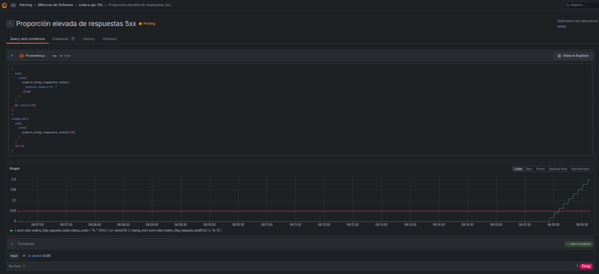
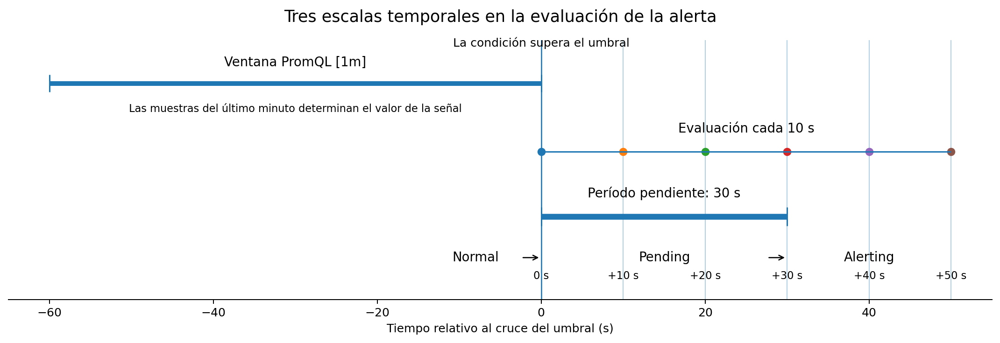

<!--
Requiere en MkDocs Material:
- admonition
- attr_list
- md_in_html
- pymdownx.details
- pymdownx.superfences
- pymdownx.tabbed:
    alternate_style: true
-->

# 3.5 Dashboards y alertas

## Objetivos de aprendizaje

Al finalizar la sesión se espera que el estudiante pueda:

- diseñar un dashboard a partir de preguntas operacionales y seleccionar las señales necesarias para responderlas;
- construir en Grafana visualizaciones alimentadas por PromQL y configurar unidades, leyendas y rangos temporales coherentes con cada magnitud;
- interpretar conjuntamente señales de actividad, errores, duración y uso de recursos, distinguiendo síntomas del servicio de evidencia contextual;
- interpretar el uso de CPU en cores y el uso de memoria dentro del alcance que permiten sus métricas;
- configurar y evaluar una regla de alerta especificando señal, umbral, intervalo de evaluación y período pendiente;
- justificar condiciones de alerta en relación con objetivos operacionales y reconocer configuraciones susceptibles de producir fatiga de alertas.

!!! question "Pregunta central"

    **¿Cómo organizar las señales de un servicio en un dashboard y definir condiciones de alerta que permitan reconocer una degradación relevante y decidir si requiere intervención?**

PromQL permite calcular magnitudes a partir de series temporales. Un dashboard organiza varias de esas magnitudes para facilitar su interpretación conjunta. Una regla de alerta evalúa periódicamente una condición y mantiene un estado que representa la evolución de esa evaluación. El diseño de ambos elementos exige decidir qué preguntas deben responderse, qué señales aportan evidencia suficiente y qué interpretación admite cada resultado.

!!! info "Conceptos retomados de sesiones anteriores"

    - **Serie temporal:** secuencia de muestras identificada por un nombre de métrica y un conjunto concreto de labels.
    - **Counter:** instrumento acumulativo cuyo valor puede convertirse en una tasa mediante `rate()`.
    - **Histogram clásico:** instrumento que representa una distribución mediante buckets acumulativos, `_sum` y `_count`.
    - **p95:** estimación del cuantil `0.95`; en un Histogram clásico su precisión depende de los límites de los buckets.
    - **RED:** estrategia que organiza señales de servicio alrededor de tasa, errores y duración.
    - **SLI y SLO:** indicador de nivel de servicio y objetivo asociado que permiten expresar cuantitativamente una expectativa de confiabilidad.

## Preparación del entorno

La práctica utiliza una variante del entorno de `orders-api` que incorpora Prometheus, Grafana y cAdvisor.

La rama de trabajo es:

```text
3.5-grafana-alerting
```

Desde la raíz del repositorio:

```bash
git fetch origin
git switch 3.5-grafana-alerting

docker compose -f compose-3.5.yaml up --build -d
```

Los componentes quedan disponibles en:

```text
orders-api   http://localhost:3000
Prometheus   http://localhost:9090
cAdvisor     http://localhost:8080
Grafana      http://localhost:3001
```

Prometheus recolecta las métricas de `orders-api` y de cAdvisor. Grafana utiliza Prometheus como fuente de datos.

!!! note "Entorno de estudiante"

    Para la actividad de clase, Grafana debe tener configurada la fuente de datos Prometheus, pero el dashboard de referencia no debe provisionarse automáticamente. El dashboard se construye manualmente a partir de la referencia visual y de las consultas proporcionadas.

El escenario de tráfico utilizado en 3.4 se ejecuta con:

```bash
npm run promql:scenario
```

La ejecución contiene cinco fases deterministas de aproximadamente 80 segundos cada una. El escenario completo dura alrededor de 6 minutos y 40 segundos. En esta sesión se ejecutará **una sola vez**, después de haber construido el dashboard y la regla de alerta.

---

## 1. Diseño de dashboards operacionales {#diseno-dashboards}

Un **dashboard operacional** es una composición de visualizaciones diseñada para responder un conjunto definido de preguntas sobre el comportamiento de un sistema. Cada panel debe representar una magnitud cuya interpretación contribuya a una decisión o a la formulación de una hipótesis.

La selección de paneles comienza por la pregunta operacional. La disponibilidad de una métrica no determina por sí sola que deba mostrarse.

### 1.1 Pregunta, señal y representación

Una secuencia de diseño útil es:

```text
pregunta operacional
        ↓
señal necesaria
        ↓
consulta o transformación
        ↓
representación y unidad
        ↓
interpretación
        ↓
decisión o nueva pregunta
```

Por ejemplo:

```text
¿Está aumentando la duración de las solicitudes?
        ↓
duración de POST /orders
        ↓
media y p95 en una ventana reciente
        ↓
serie temporal en segundos
        ↓
comparación de tendencia y distribución
```

El nombre `orders_http_request_duration_seconds` identifica una familia de métricas. El panel debe comunicar además qué magnitud se interpreta y con qué propósito.

La documentación de Grafana recomienda diseñar dashboards con un propósito explícito, orientados a responder preguntas y a reducir la carga cognitiva de interpretación. Véase [Grafana: Dashboard best practices](https://grafana.com/docs/grafana/latest/visualizations/dashboards/build-dashboards/best-practices/).

### 1.2 Jerarquía de información

El dashboard de esta sesión se organiza en dos niveles.

**Señales del servicio**

Describen directamente el comportamiento observable a través de la interfaz del servicio:

```text
actividad
errores
duración
```

**Evidencia contextual**

Describe condiciones internas del entorno de ejecución:

```text
uso de CPU
uso de memoria
```

Un aumento de errores o duración constituye evidencia de degradación del servicio. Las métricas de recursos pueden apoyar o debilitar hipótesis sobre posibles mecanismos, pero requieren evidencia adicional para establecer una explicación causal.

### 1.3 Unidades, escalas y rango temporal

Una visualización debe indicar qué magnitud representa y en qué unidad se expresa. El mismo valor numérico puede tener interpretaciones diferentes si cambia su unidad o referencia.

| Señal | Unidad de presentación |
|---|---|
| tasa de solicitudes | `req/s` |
| proporción de 5xx | porcentaje |
| duración | segundos o milisegundos |
| CPU | cores |
| memoria | bytes, presentados como MiB cuando corresponda |

El rango temporal forma parte de la interpretación. Para observar el escenario A-E completo conviene utilizar una ventana de 10 a 15 minutos.

### 1.4 Errores de diseño

Un dashboard puede ser técnicamente correcto y dificultar la interpretación. Entre los problemas que deben evitarse se encuentran:

- utilizar nombres de métricas como títulos sin indicar la magnitud operacional;
- omitir unidades;
- mezclar señales con escalas incompatibles sin una razón explícita;
- mostrar demasiadas series en un mismo panel;
- utilizar un valor instantáneo cuando la pregunta requiere conocer la evolución temporal;
- aplicar umbrales visuales sin una referencia que justifique sus valores;
- organizar los paneles por tecnología en lugar de por las preguntas que deben responderse.

---

## 2. Visualización de señales del servicio en Grafana {#grafana-servicio}

Grafana consulta Prometheus y representa el resultado de una expresión PromQL. PromQL determina la magnitud calculada; Grafana determina su representación.

```text
PromQL  → magnitud calculada
Grafana → representación de la magnitud
```

### 2.1 Actividad guiada: reproducir el dashboard de referencia

La figura siguiente muestra la solución de referencia.

<figure markdown="span">
  { width="100%" loading="lazy" }
  <figcaption>Figura 1. Dashboard de referencia para observar actividad, errores, duración y uso de recursos de <code>orders-api</code> durante el escenario A-E. La captura corresponde a una ejecución reproducible del entorno de clase.</figcaption>
</figure>

El dashboard de referencia utiliza cinco paneles de serie temporal porque el análisis requiere comparar la evolución de las señales. La reproducción debe preservar esa capacidad de comparación temporal; no se exige replicar cada detalle visual.

La construcción se realiza en dos etapas. En esta sección se crean los tres paneles de servicio. En la sección 3 se incorporan CPU y memoria.

!!! task "Actividad guiada"

    Construir en Grafana un dashboard que, al completarse, permita responder:

    1. ¿A qué tasa está recibiendo solicitudes el servicio?
    2. ¿Qué proporción de solicitudes termina en respuestas 5xx?
    3. ¿Cómo evoluciona la duración de `POST /orders` y qué diferencia se observa entre media y p95?
    4. ¿Cuántos cores equivalentes utiliza el contenedor?
    5. ¿Cómo evoluciona el uso de memoria del contenedor?

    Utilizar la figura como referencia para la disposición general. Las consultas y requisitos mínimos se presentan a continuación.

### 2.2 Tasa de solicitudes

Pregunta operacional:

> ¿A qué tasa está recibiendo solicitudes el servicio?

Consulta:

```promql
sum(
  rate(
    orders_http_requests_total[1m]
  )
)
```

Configuración mínima:

```text
Título: Tasa de solicitudes
Visualización en Grafana: Time series
Unidad: req/s
Mínimo: 0
```

La expresión calcula la tasa total de solicitudes por segundo a partir del Counter instrumentado en la aplicación.

Durante el escenario de referencia se espera distinguir aproximadamente:

```text
fase A   1 req/s
fase B   4 req/s
fase C   4 req/s
fase D   4 req/s
fase E   1 req/s
```

Las transiciones se suavizan por el uso de la ventana `[1m]`.

### 2.3 Proporción de respuestas 5xx

Pregunta operacional:

> ¿Qué fracción de las solicitudes termina con un código de respuesta 5xx?

Consulta:

```promql
sum(
  rate(
    orders_http_requests_total{
      status_code=~"5.."
    }[1m]
  )
)
/
sum(
  rate(
    orders_http_requests_total[1m]
  )
)
```

Configuración mínima:

```text
Título: Proporción de respuestas 5xx
Visualización en Grafana: Time series
Unidad en Grafana: Percent (0.0-1.0)
Mínimo: 0
Máximo: 1
```

PromQL devuelve una proporción entre `0` y `1`. Grafana la presenta como porcentaje.

Durante la fase C, la ejecución de referencia produce aproximadamente una cuarta parte de respuestas 5xx. La ventana temporal hace que la serie aumente y disminuya gradualmente.

### 2.4 Duración de `POST /orders`

La duración se representa mediante dos expresiones.

**Media**

```promql
sum(
  rate(
    orders_http_request_duration_seconds_sum{
      route="/orders"
    }[1m]
  )
)
/
sum(
  rate(
    orders_http_request_duration_seconds_count{
      route="/orders"
    }[1m]
  )
)
```

**p95**

```promql
histogram_quantile(
  0.95,
  sum by (le) (
    rate(
      orders_http_request_duration_seconds_bucket{
        route="/orders"
      }[1m]
    )
  )
)
```

Configuración mínima:

```text
Título: Duración de POST /orders
Visualización en Grafana: Time series
Unidad: seconds
Leyenda A: media
Leyenda B: p95
Mínimo: 0
```

La media describe el valor promedio reciente. `histogram_quantile()` estima el cuantil `0.95` de la distribución representada por los buckets del Histogram clásico.

!!! note "Interpretación del p95"

    El p95 es una estimación basada en los buckets. Un resultado como `0.95 s` no implica que se haya observado una solicitud individual con duración de `0.95 s`.

### 2.5 Primera etapa del dashboard

Al terminar esta sección deben existir tres paneles:

```text
Tasa de solicitudes
Proporción de respuestas 5xx
Duración de POST /orders
```

El dashboard se conserva para la segunda etapa de construcción. El escenario A-E se ejecutará después de incorporar las métricas de recursos y configurar la regla de alerta.

---

## 3. Métricas de recursos con cAdvisor {#cadvisor-recursos}

cAdvisor obtiene métricas sobre el uso de recursos de los contenedores. Prometheus recolecta esas métricas desde el endpoint de cAdvisor y Grafana las consulta desde la misma fuente de datos.

En este entorno, `orders-api` se identifica mediante:

```text
container_label_com_docker_compose_service="orders-api"
```

Las consultas siguientes fueron verificadas en la ejecución de referencia.

### 3.1 Uso de CPU en cores

cAdvisor expone:

```promql
container_cpu_usage_seconds_total
```

Esta métrica es un Counter de tiempo de CPU acumulado. La tasa de consumo reciente se obtiene con:

```promql
sum(
  rate(
    container_cpu_usage_seconds_total{
      job="cadvisor",
      container_label_com_docker_compose_service="orders-api",
      cpu="total"
    }[1m]
  )
)
```

El resultado tiene la forma:

\[
\frac{\text{segundos de CPU}}{\text{segundos de tiempo}}
\]

y se interpreta operacionalmente como **cores equivalentes utilizados**.

```text
0.25 → aproximadamente 0.25 cores
1.00 → aproximadamente 1 core
1.50 → aproximadamente 1.5 cores
```

Configuración mínima:

```text
Título: Uso de CPU de orders-api
Visualización en Grafana: Time series
Unidad: cores
Mínimo: 0
```

!!! warning "Alcance de la métrica"

    El valor expresa consumo de CPU. Para evaluar saturación debe conocerse además la capacidad disponible o el límite asignado al contenedor.

En la ejecución de referencia, el consumo permaneció aproximadamente entre `0.055` y `0.073` cores. La degradación de duración observada durante las fases C y D no estuvo acompañada por un aumento comparable de CPU.

El escenario introduce las demoras mediante espera asíncrona:

```javascript
const delay = (ms) =>
  new Promise((resolve) => setTimeout(resolve, ms));
```

y:

```javascript
await delay(scenarioDelay[scenario]);
```

Una solicitud puede acumular cientos de milisegundos de duración sin mantener la CPU ocupada durante todo ese intervalo.

### 3.2 Uso de memoria

cAdvisor expone:

```promql
container_memory_usage_bytes
```

Esta métrica es un Gauge del uso actual de memoria contabilizada para el contenedor. Incluye memoria independientemente de cuándo fue accedida. cAdvisor expone por separado `container_memory_working_set_bytes`; esta sesión utiliza `container_memory_usage_bytes` para observar la evolución del consumo contabilizado.

Consulta:

```promql
sum(
  container_memory_usage_bytes{
    job="cadvisor",
    container_label_com_docker_compose_service="orders-api"
  }
)
```

Configuración mínima:

```text
Título: Uso de memoria de orders-api
Visualización en Grafana: Time series
Unidad: bytes
Mínimo: 0
```

Grafana puede presentar automáticamente los bytes como MiB.

En la ejecución de referencia se observó un crecimiento desde aproximadamente `27 MiB` hasta una zona cercana a `36 MiB`, además de picos transitorios próximos a `47 MiB`.

La serie permite afirmar que el uso de memoria contabilizado aumentó durante la ejecución. Ese resultado no caracteriza por sí solo presión ni saturación. Para evaluar esas condiciones serían necesarias señales adicionales, por ejemplo:

- límite de memoria asignado;
- proximidad a ese límite;
- eventos de memoria;
- métricas del heap o del recolector de basura;
- fallos de asignación u OOM.

### 3.3 Síntomas y evidencia contextual

Las señales del dashboard cumplen funciones distintas:

```text
tasa de solicitudes ─┐
errores 5xx          ├─ comportamiento observable del servicio
duración             ┘

CPU                  ┐
memoria              ┴─ evidencia contextual sobre recursos
```

Un patrón como:

```text
p95 aumenta
CPU permanece alrededor de 0.06 cores
```

debilita una hipótesis basada exclusivamente en saturación de CPU.

Una conclusión compatible con la evidencia es:

> La ejecución presenta degradación de duración sin evidencia de consumo elevado de CPU.

Afirmar que la CPU no interviene en ningún aspecto del comportamiento requeriría evidencia adicional.

### 3.4 Completar el dashboard

Se agregan los paneles de CPU y memoria al dashboard. El dashboard completo debe contener:

```text
Tasa de solicitudes
Proporción de respuestas 5xx
Duración de POST /orders
Uso de CPU de orders-api
Uso de memoria de orders-api
```

Antes de continuar, se verifica que las cinco consultas produzcan datos y que los paneles compartan un rango temporal común. El escenario A-E se ejecutará después de configurar la regla de alerta.

---

## 4. Diseño y evaluación de alertas {#alertas}

Una regla de alerta evalúa periódicamente una condición y mantiene un estado de acuerdo con el resultado de esa evaluación y con la persistencia configurada.

### 4.1 Componentes de una regla

Para esta sesión se utilizarán cuatro elementos:

```text
señal
  ↓
umbral
  ↓
intervalo de evaluación
  ↓
período pendiente
```

La señal seleccionada será la proporción de respuestas 5xx.

Consulta:

```promql
(
  sum(
    rate(
      orders_http_requests_total{
        status_code=~"5.."
      }[1m]
    )
  )
  or vector(0)
)
/
clamp_min(
  sum(
    rate(
      orders_http_requests_total[1m]
    )
  ),
  1e-12
)
```

El numerador utiliza `or vector(0)` para producir cero cuando no existe todavía una serie 5xx. `clamp_min(..., 1e-12)` establece un límite inferior para el denominador cuando la serie total existe pero su tasa reciente es cero. Esta construcción no sustituye el tratamiento de `No Data` cuando falta la telemetría.

La condición didáctica será:

```text
proporción de 5xx > 0.05
```

equivalente a un 5 %.

!!! warning "Umbral didáctico"

    El `5 %` se utiliza para hacer observable el mecanismo durante el escenario A-E. No constituye un umbral universal ni una recomendación para producción.

### 4.2 Condición y estado de la instancia

La condición y el estado de la instancia representan niveles distintos de la evaluación.

En la ejecución de referencia, el bloque de condición aparecía como `Firing` mientras la regla completa se encontraba en `Pending`.

<figure markdown="span">
  { width="100%" loading="lazy" }
  <figcaption>Figura 2. Regla durante la fase C. La condición <code>proporción de 5xx &gt; 0.05</code> ya es verdadera, mientras la instancia permanece en <code>Pending</code> hasta completar el período pendiente.</figcaption>
</figure>

Para una condición de umbral y con `Keep firing for = 0`, el experimento utiliza:

```text
Normal
  ↓ condición verdadera
Pending
  ↓ se mantiene durante 30 s
Alerting
  ↓ condición falsa
Normal
```

Grafana contempla además estados asociados a recuperación, ausencia de datos y errores de evaluación.

### 4.3 Intervalo de evaluación y período pendiente

La configuración didáctica es:

```text
Evaluation interval = 10 s
Pending period      = 30 s
Keep firing for     = 0 s
```

El **intervalo de evaluación** determina cada cuánto Grafana vuelve a ejecutar la regla.

El **período pendiente** determina cuánto tiempo debe mantenerse verdadera la condición antes de pasar de `Pending` a `Alerting`.

`Keep firing for` controla cuánto tiempo puede mantenerse activa la alerta después de que la condición deja de cumplirse. En el experimento se utiliza `0 s`.

### 4.4 Tres escalas temporales

La evaluación combina tres escalas temporales diferentes.

<figure markdown="span">
  { width="100%" loading="lazy" }
  <figcaption>Figura 3. La ventana <code>[1m]</code> determina qué muestras intervienen en la señal, el intervalo de 10 s determina cuándo se vuelve a evaluar la regla y el período pendiente de 30 s determina cuánto debe mantenerse verdadera la condición antes de pasar a <code>Alerting</code>.</figcaption>
</figure>

La ventana:

```promql
rate(...[1m])
```

determina cómo evoluciona el valor calculado de la señal.

El intervalo:

```text
10 s
```

determina la frecuencia de evaluación.

El período pendiente:

```text
30 s
```

determina la persistencia exigida antes de activar la alerta.

El final de la fase C no implica que la proporción de errores caiga inmediatamente a cero, porque la ventana `[1m]` conserva temporalmente muestras del comportamiento anterior.

### 4.5 Actividad guiada: crear la regla

En Grafana:

```text
Alerts & IRM
→ Alerting
→ Alert rules
→ New alert rule
```

Configuración:

```text
Name:
Proporción elevada de respuestas 5xx

Query:
expresión PromQL anterior

Query type:
Instant

Condition:
IS ABOVE 0.05

Folder:
Métricas de Software

Evaluation group:
orders-api-10s

Evaluation interval:
10s

Pending period:
30s

Keep firing for:
None / 0s
```

Los labels pueden describir la regla:

```text
service = orders-api
signal  = errors
```

No se configura un `Contact point`, porque el alcance de la sesión se limita a la evaluación y al ciclo de vida de la regla. Una vez guardada la regla, dashboard y alerta quedan preparados para ejecutar el escenario.

??? note "Ampliación: `No Data` y `Error`"

    Grafana distingue estados relacionados con problemas de evaluación.

    - `No Data`: la consulta se ejecutó, pero no produjo puntos de datos.
    - `Error`: la regla no pudo evaluarse correctamente.

    La ausencia de datos requiere tratamiento explícito y no debe interpretarse automáticamente como un valor saludable. El comportamiento ante estos estados es configurable.

    Véase [Grafana: No Data and Error states](https://grafana.com/docs/grafana/latest/alerting/fundamentals/alert-rule-evaluation/nodata-and-error-states/).

---

## 5. Criterios para el diseño de alertas {#criterios-alertas}

Una regla técnicamente válida puede ser operacionalmente deficiente. El diseño debe justificar por qué una condición merece atención y qué acción puede seguirse de ella.

### 5.1 Accionabilidad

Una pregunta útil para revisar una alerta es:

> Si esta condición se cumple, ¿qué decisión o acción debería iniciar?

Una regla como:

```text
CPU > 80 %
```

solo puede interpretarse si se define la referencia de capacidad, el comportamiento esperado del servicio, el posible impacto sobre usuarios y la acción asociada a su incumplimiento.

Una proporción elevada de errores representa directamente un síntoma del servicio y puede vincularse con una acción operacional más concreta.

Google SRE recomienda distinguir síntomas de causas y priorizar alertas que representen problemas accionables para el servicio. Véase [Google SRE: Monitoring Distributed Systems](https://sre.google/sre-book/monitoring-distributed-systems/).

### 5.2 Umbrales y objetivos del servicio

Todo umbral requiere una referencia.

La pregunta:

```text
¿por qué 5 %?
```

debe responderse mediante evidencia o mediante un objetivo operacional.

Un SLO proporciona una base para definir qué nivel de error es tolerable y cuándo una degradación consume el presupuesto de error a una velocidad preocupante.

```text
SLI
 ↓
SLO
 ↓
error permitido
 ↓
presupuesto de error
 ↓
condición que justifica intervención
```

La sesión no desarrolla reglas multi-window y multi-burn-rate. La comparación se limita a distinguir un umbral elegido para una demostración de una condición derivada de un objetivo de confiabilidad.

Para una ampliación puede consultarse [Google SRE Workbook: Alerting on SLOs](https://sre.google/workbook/alerting-on-slos/).

### 5.3 Fatiga de alertas (*alert fatigue*)

La **fatiga de alertas** es la reducción de la capacidad de responder adecuadamente a eventos relevantes como consecuencia de un volumen elevado de notificaciones poco significativas, redundantes o no accionables.

Entre las decisiones que pueden incrementar el ruido se encuentran:

```text
umbral excesivamente sensible
ventana temporal inadecuada
período pendiente demasiado corto
reglas redundantes
alertas sobre condiciones sin impacto
```

La consecuencia operacional puede representarse como:

```text
más notificaciones
      ↓
menor relación señal / ruido
      ↓
menor atención a eventos relevantes
```

Una política de alertas debe priorizar condiciones suficientemente relevantes como para justificar una respuesta.

---

## 6. Análisis integrado de `orders-api` {#analisis-integrado}

Una vez preparados el dashboard y la regla, se realiza una única ejecución del escenario A-E. Esta ejecución produce la evidencia utilizada para analizar servicio, recursos y alerta en el mismo intervalo temporal.

### 6.1 Escenario A-E

La configuración es determinista:

| Fase | Tasa aproximada | Comportamiento de `POST /orders` | Efecto esperado en el servicio |
|---|---:|---|---|
| A | 1 req/s | normal | referencia |
| B | 4 req/s | normal | mayor actividad |
| C | 4 req/s | alterna normal y `payment-timeout` | 5xx y mayor duración |
| D | 4 req/s | `slow` | mayor duración sin el mismo patrón de 5xx |
| E | 1 req/s | normal | retorno a referencia |

Los retrasos nominales de `POST /orders` son:

```text
normal           0.08 s
slow             0.35 s
payment-timeout  0.70 s
```

Estos valores son datos didácticos deterministas. No constituyen un benchmark de Node.js, Express, Docker, Prometheus o Grafana.

### 6.2 Ejecución y observación

Antes de iniciar el escenario se mantienen abiertos el dashboard y la regla de alerta en Grafana. Se configura un rango temporal suficiente para observar toda la ejecución y un refresco coherente con el `scrape_interval`.

El escenario se ejecuta una sola vez:

```bash
npm run promql:scenario
```

Durante la ejecución se observan:

```text
actividad
proporción de 5xx
media y p95
CPU
memoria
estado de la regla
```

El análisis relaciona las señales dentro de un mismo intervalo temporal.

### 6.3 Preguntas de análisis

!!! question "Actividad de interpretación"

    1. ¿En qué intervalo aumenta la actividad y qué señal permite afirmarlo?
    2. ¿En qué intervalo aparece degradación de disponibilidad?
    3. ¿La media y el p95 describen exactamente el mismo comportamiento de duración?
    4. ¿Existe evidencia de consumo elevado de CPU durante el episodio de mayor duración?
    5. ¿Qué cambia en el uso de memoria y qué no puede concluirse a partir de esa serie?
    6. ¿Cuándo comienza a cumplirse la condición de la regla?
    7. ¿Por qué la regla puede permanecer en `Pending` aunque la condición ya aparezca como `Firing`?
    8. ¿Por qué la alerta puede tardar en volver a `Normal` después de terminar la fase C?
    9. ¿Qué evidencia adicional sería necesaria para atribuir la degradación a CPU o memoria?

### 6.4 Evidencia, interpretación e hipótesis

Un análisis compatible con la ejecución de referencia es:

```text
evidencia:
p95 aumenta de forma marcada

evidencia:
aparecen respuestas 504

evidencia adicional:
CPU permanece alrededor de una fracción pequeña de un core

interpretación:
existe degradación de duración y disponibilidad,
sin evidencia de consumo elevado de CPU

mecanismo conocido del escenario:
las demoras se simulan mediante espera asíncrona
```

La métrica de CPU permite debilitar una hipótesis de saturación de CPU.

Para memoria:

```text
evidencia:
el uso contabilizado aumenta y presenta picos

interpretación:
el proceso utiliza más memoria durante la ejecución

hipótesis que requiere evidencia adicional:
el comportamiento de memoria contribuye a la degradación
```

Una explicación causal requiere señales relacionadas con el mecanismo propuesto.

### 6.5 Alcance de la alerta

La regla utilizada permite observar el ciclo de evaluación, pero sus parámetros fueron elegidos para el experimento:

```text
5 % de 5xx
ventana de 1 minuto
evaluación cada 10 s
período pendiente de 30 s
```

Una regla destinada a producción debería justificar:

- qué SLI representa;
- qué SLO o riesgo operacional protege;
- qué umbral utiliza;
- durante cuánto tiempo debe mantenerse;
- qué acción debe iniciar;
- qué tratamiento aplica a `No Data` y `Error`;
- qué canal y política de notificación corresponde.

---

## Síntesis {#sintesis}

Un dashboard operacional organiza señales para responder preguntas definidas sobre el comportamiento de un servicio. La selección de paneles, consultas, unidades y rangos temporales condiciona las interpretaciones posibles.

Las señales de servicio permiten reconocer síntomas como errores o aumento de duración. Las métricas de CPU y memoria aportan evidencia contextual para evaluar hipótesis sobre el entorno de ejecución. La coincidencia temporal entre señales puede motivar una hipótesis. Una explicación causal exige evidencia adicional sobre el mecanismo propuesto.

Una regla de alerta convierte una señal en una condición evaluada periódicamente. La ventana de la consulta, el intervalo de evaluación y el período pendiente cumplen funciones diferentes y deben analizarse por separado. Un umbral adquiere significado operacional cuando existe una razón para considerar relevante su incumplimiento.

Los dashboards y las alertas son mecanismos para organizar evidencia y sustentar decisiones técnicas. Su calidad depende de la relación entre pregunta, señal, contexto y acción.

## Referencias {#referencias}

- Grafana Labs. [Dashboard best practices](https://grafana.com/docs/grafana/latest/visualizations/dashboards/build-dashboards/best-practices/).
- Grafana Labs. [Alert rule evaluation](https://grafana.com/docs/grafana/latest/alerting/fundamentals/alert-rule-evaluation/).
- Grafana Labs. [Configure Grafana-managed alert rules](https://grafana.com/docs/grafana/latest/alerting/alerting-rules/create-grafana-managed-rule/).
- Grafana Labs. [No Data and Error states](https://grafana.com/docs/grafana/latest/alerting/fundamentals/alert-rule-evaluation/nodata-and-error-states/).
- Google. [Site Reliability Engineering: Monitoring Distributed Systems](https://sre.google/sre-book/monitoring-distributed-systems/).
- Google. [The Site Reliability Workbook: Alerting on SLOs](https://sre.google/workbook/alerting-on-slos/).
- Google cAdvisor. [Prometheus metrics documentation](https://github.com/google/cadvisor/blob/master/docs/storage/prometheus.md).
- Prometheus. [Query functions](https://prometheus.io/docs/prometheus/latest/querying/functions/).
