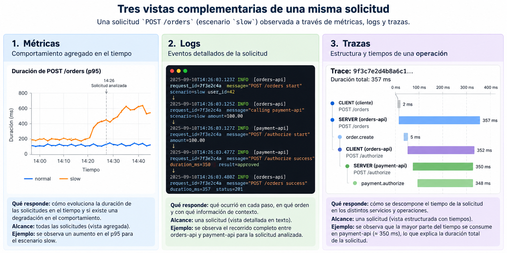
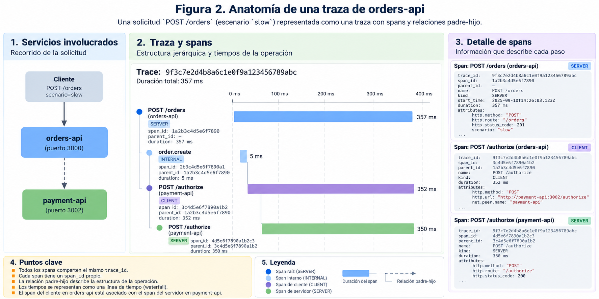
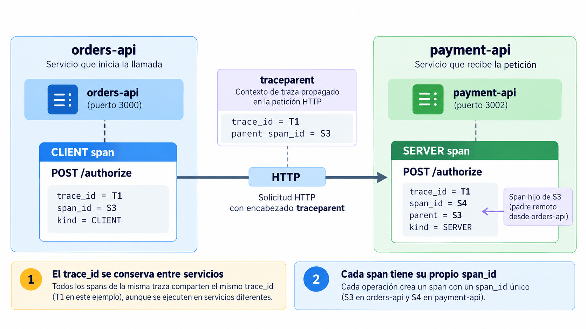
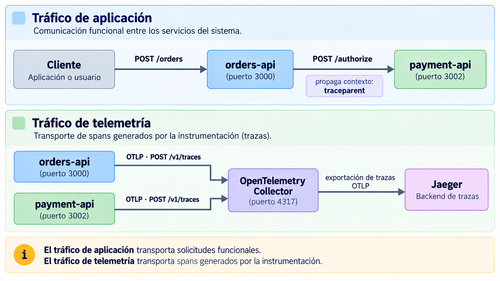

# 3.6 OpenTelemetry: instrumentación, contexto y exportación de trazas

## Propósito

En las sesiones anteriores, `orders-api` se utilizó para estudiar métricas de servicio, PromQL, dashboards y alertas. Ese trabajo permitió observar comportamiento agregado: tasa de solicitudes, proporción de errores, solicitudes en ejecución y distribuciones de duración.

La rama `3.6-opentelemetry` introduce un segundo servicio:

```text
cliente
   |
   | POST /orders
   v
orders-api
   |
   | POST /authorize
   v
payment-api
```

Los escenarios `normal`, `slow` y `payment-timeout` se mantienen, pero la autorización de pago ocurre ahora mediante una llamada HTTP real entre dos procesos.

Esta modificación introduce una nueva pregunta operacional:

> Para una solicitud de creación de orden, ¿qué operaciones se ejecutaron en cada servicio, cómo se relacionan y cuánto tiempo consumió cada una?

OpenTelemetry proporciona el modelo de instrumentación y el contexto necesarios para producir esa evidencia.

Al finalizar la sesión se deberá poder:

1. describir una traza mediante spans, relaciones padre-hijo e identificadores de contexto;
2. explicar cómo el contexto se conserva dentro de un proceso y se propaga entre `orders-api` y `payment-api`;
3. distinguir qué información puede obtenerse mediante instrumentación automática y qué requiere instrumentación manual;
4. explicar el recorrido de una traza desde la aplicación hasta un backend mediante OTLP y OpenTelemetry Collector.

---

# 1. El caso de estudio: `orders-api` y `payment-api`

La creación de una orden comienza en:

```text
POST /orders
```

`orders-api` valida el escenario y solicita una autorización a:

```text
POST /authorize
```

en `payment-api`.

Los comportamientos continúan siendo deterministas:

| Escenario | `payment-api` | Resultado de `orders-api` |
|---|---:|---|
| `normal` | responde en aproximadamente 80 ms | HTTP 201 |
| `slow` | responde en aproximadamente 350 ms | HTTP 201 |
| `payment-timeout` | responde en aproximadamente 700 ms con HTTP 504 | HTTP 504 |

Las métricas ya utilizadas permiten observar estos cambios sobre muchas solicitudes. Por ejemplo, el histograma:

```text
orders_http_request_duration_seconds
```

permite obtener media, p95 y distribución aproximada de duración.

Una serie temporal puede mostrar que el p95 aumentó. No representa, por sí misma, la estructura interna de una solicitud particular.

Para una solicitud concreta se necesita una representación como:

```text
POST /orders                            357 ms
|
+-- order.create                        355 ms
    |
    +-- POST /authorize                 352 ms
            |
            v
        payment-api
        POST /authorize                 350 ms
        |
        +-- payment.authorize           349 ms
```

Esta estructura permite observar:

```text
qué operaciones participaron
qué operación llamó a cuál
qué servicio ejecutó cada operación
cuándo comenzó y terminó cada una
dónde se observa la mayor parte del tiempo
```

Una **traza** representa este tipo de ejecución.



## 1.1 Lo que una traza puede establecer

Considérese:

```text
POST /orders                            706 ms
|
+-- POST /authorize                     701 ms
        |
        +-- payment.authorize           700 ms
```

La evidencia permite afirmar que la mayor parte de la duración de `POST /orders` se observa dentro del camino de autorización de pago.

No permite afirmar todavía que la causa sea:

```text
CPU
red
I/O
contención
saturación
bloqueo
```

La traza localiza dónde se observa el tiempo. La explicación del mecanismo puede requerir otras fuentes de evidencia.

---

# 2. Modelo de trazas en OpenTelemetry

OpenTelemetry reúne especificaciones, APIs, SDKs, convenciones semánticas, librerías de instrumentación y componentes para producir y transportar telemetría.

Dentro de una aplicación, la estructura básica es:

```text
código instrumentado
        |
        v
OpenTelemetry API
        |
        v
OpenTelemetry SDK
        |
        v
exporter
```

La API define las operaciones disponibles para instrumentar código. El SDK implementa la producción, procesamiento y exportación de la señal.

Por ejemplo:

```js
import { trace } from "@opentelemetry/api";

const tracer = trace.getTracer("orders-api");
```

El `Tracer` permite crear spans que representan operaciones.

## 2.1 Trace y span

Una **traza** (`trace`) representa una ejecución lógica formada por operaciones relacionadas.

Un **span** representa una operación con un inicio y un final.

```text
Trace
|
+-- Span
    |
    +-- Span
        |
        +-- Span
```

Un span puede contener:

```text
nombre
trace_id
span_id
parent span
tiempo de inicio
tiempo de finalización
atributos
eventos
estado
tipo de span
```

Ejemplo conceptual:

```text
trace_id = 4d2f...

POST /orders
span_id = a100

    order.create
    span_id = a200

        POST /authorize
        span_id = a300
```

Todos los spans pertenecen a la misma traza porque comparten el mismo `trace_id`.

Cada operación tiene un `span_id` propio.

La relación padre-hijo conserva la estructura de ejecución:

```text
POST /orders
    |
    +-- order.create
            |
            +-- POST /authorize
```



## 2.2 Duración y relaciones temporales

Cada span registra tiempo de inicio y finalización.

```text
duration = end_time - start_time
```

La duración de un span padre puede incluir la duración de sus hijos.

Por ejemplo:

```text
POST /orders                 357 ms
|
+-- order.create             355 ms
    |
    +-- POST /authorize      352 ms
```

No sería correcto sumar:

```text
357 + 355 + 352
```

como si fueran tres tiempos independientes.

Las operaciones están anidadas. Parte del tiempo de `POST /orders` corresponde al tiempo consumido dentro de `order.create`, y parte del tiempo de `order.create` corresponde a la llamada `POST /authorize`.

## 2.3 Tipos de span

OpenTelemetry utiliza `SpanKind` para describir la relación de una operación con otros componentes.

Para este sistema interesan tres valores:

| `SpanKind` | Uso |
|---|---|
| `SERVER` | recepción de una operación remota |
| `CLIENT` | llamada remota saliente |
| `INTERNAL` | trabajo local dentro del proceso |

La llamada entre servicios puede representarse así:

```text
orders-api                         payment-api

CLIENT POST /authorize  ------->  SERVER POST /authorize
```

Dentro de cada servicio pueden existir operaciones internas:

```text
orders-api
SERVER POST /orders
|
+-- INTERNAL order.create
    |
    +-- CLIENT POST /authorize

payment-api
SERVER POST /authorize
|
+-- INTERNAL payment.authorize
```

La instrumentación automática puede crear los spans HTTP. Los spans que representan conceptos del dominio suelen requerir instrumentación manual.

---

# 3. Contexto y propagación entre servicios

Las relaciones entre spans requieren conservar información sobre la ejecución activa.

OpenTelemetry utiliza un **Context** para asociar información con la ejecución actual.

Para tracing, la parte central es el **Span Context**, que contiene, entre otros datos:

```text
trace_id
span_id
trace_flags
trace_state
```

Dentro de un proceso, el contexto permite que un nuevo span se relacione con la operación que ya está activa.

```js
await tracer.startActiveSpan("order.create", async (span) => {
  try {
    await authorizePayment();
  } finally {
    span.end();
  }
});
```

Mientras se ejecuta el callback, `order.create` permanece activo.

Si dentro de esa operación se crea otro span, puede quedar asociado como hijo.

```text
order.create
    |
    +-- otra operación
```

En Node.js, el contexto debe mantenerse correctamente a través de operaciones asíncronas como:

```text
Promises
await
callbacks
timers
clientes HTTP
middleware
```

El SDK configura un mecanismo de gestión de contexto para conservar esa relación lógica.

## 3.1 Propagación por HTTP

El contexto en memoria pertenece a un proceso.

Cuando `orders-api` llama a `payment-api`, la relación debe cruzar la red:

```text
orders-api
    |
    | HTTP
    v
payment-api
```

Para ello se serializa información del contexto dentro de la solicitud.

En HTTP, OpenTelemetry utiliza normalmente W3C Trace Context.

El encabezado principal es:

```text
traceparent
```

Su estructura general es:

```text
version-traceid-parentid-flags
```

Ejemplo:

```text
traceparent:
00-4bf92f3577b34da6a3ce929d0e0e4736-00f067aa0ba902b7-01
```

Los campos representan:

```text
versión
trace_id
span_id del contexto propagado
trace flags
```

Supóngase que `orders-api` tiene:

```text
CLIENT POST /authorize
trace_id = T1
span_id  = S3
```

La instrumentación inyecta ese contexto en la solicitud HTTP.

`payment-api` lo extrae y crea:

```text
SERVER POST /authorize
trace_id       = T1
span_id        = S4
remote parent  = S3
```

La red separa los procesos, pero el `trace_id` conserva la pertenencia a la misma traza.



## 3.2 Identificadores con funciones diferentes

El sistema puede utilizar varios identificadores al mismo tiempo.

| Identificador | Función |
|---|---|
| `order_id` | identifica una entidad del dominio |
| `request_id` | correlaciona una solicitud según las reglas de la aplicación |
| `trace_id` | identifica una traza completa |
| `span_id` | identifica una operación dentro de la traza |

Ejemplo:

```text
order_id   = ord-1042
request_id = req-6a73
trace_id   = 4bf92f3577b34da6a3ce929d0e0e4736
```

Una orden puede participar en varias solicitudes.

Una solicitud distribuida puede contener varios spans.

`trace_id` representa el conjunto de operaciones que forman una ejecución.

Una arquitectura de observabilidad puede incorporar `trace_id` y `span_id` en los logs para permitir navegación entre ambas señales.

---

# 4. Instrumentación de `orders-api` y `payment-api`

La instrumentación puede dividirse en dos mecanismos complementarios:

```text
automática
manual
```

La instrumentación automática conoce librerías y frameworks.

La instrumentación manual conoce el significado de las operaciones propias del sistema.

## 4.1 Instrumentación automática

Una librería de instrumentación para HTTP o Express puede crear spans sin introducir llamadas manuales en cada handler.

En `orders-api` puede observar:

```text
SERVER POST /orders
CLIENT POST /authorize
```

En `payment-api` puede observar:

```text
SERVER POST /authorize
```

La instrumentación también puede encargarse de inyectar y extraer el contexto HTTP.

Una configuración básica en Node.js puede utilizar `NodeSDK`:

```js
import { NodeSDK } from "@opentelemetry/sdk-node";
import { getNodeAutoInstrumentations } from
  "@opentelemetry/auto-instrumentations-node";
import { OTLPTraceExporter } from
  "@opentelemetry/exporter-trace-otlp-http";
import { resourceFromAttributes } from
  "@opentelemetry/resources";
import { ATTR_SERVICE_NAME } from
  "@opentelemetry/semantic-conventions";

const exporter = new OTLPTraceExporter({
  url: "http://otel-collector:4318/v1/traces"
});

const sdk = new NodeSDK({
  resource: resourceFromAttributes({
    [ATTR_SERVICE_NAME]: "orders-api"
  }),
  traceExporter: exporter,
  instrumentations: [
    getNodeAutoInstrumentations()
  ]
});

sdk.start();
```

La instrumentación debe cargarse antes de las librerías que pretende observar.

```text
OpenTelemetry
    ↓
instrumentaciones
    ↓
Express y código de aplicación
```

Si Express o HTTP se cargan antes de registrar la instrumentación, parte de las operaciones puede quedar fuera de los hooks utilizados por OpenTelemetry.

## 4.2 Instrumentación manual

La instrumentación automática reconoce una llamada HTTP, pero no necesariamente sabe que esa llamada forma parte de la creación de una orden.

Para representar operaciones de dominio pueden agregarse spans manuales.

En `orders-api`:

```js
await tracer.startActiveSpan("order.create", async (span) => {
  try {
    await executeOrderCreation();
  } finally {
    span.end();
  }
});
```

En `payment-api`:

```js
await tracer.startActiveSpan("payment.authorize", async (span) => {
  try {
    await executeAuthorization();
  } finally {
    span.end();
  }
});
```

La estructura resultante puede ser:

```text
SERVER POST /orders                 automática
|
+-- order.create                    manual
    |
    +-- CLIENT POST /authorize      automática
            |
            v
        SERVER POST /authorize      automática
        |
        +-- payment.authorize       manual
```

La instrumentación automática conserva la estructura técnica.

La instrumentación manual agrega semántica propia del sistema.

## 4.3 Información que describe un span

Un span puede enriquecerse con atributos, eventos y estado.

### Atributos

Los atributos describen propiedades de la operación:

```js
span.setAttributes({
  "order.scenario": scenario,
  "order.result": "created"
});
```

Los atributos deben responder preguntas útiles durante el análisis.

No conviene copiar automáticamente todo el request.

Un identificador de alta cardinalidad, como `order_id`, puede ser útil para buscar una traza concreta, pero su uso debe considerar:

```text
utilidad
indexación
volumen
retención
sensibilidad
```

El criterio es distinto del utilizado para labels de Prometheus, pero sigue existiendo un costo.

### Convenciones semánticas

OpenTelemetry define **semantic conventions** para conceptos comunes.

Sin convenciones, distintas aplicaciones podrían utilizar:

```text
http_method
http.method
request.method
method
```

para representar una misma propiedad.

Cuando existe una convención aplicable, debe preferirse frente a un nombre local.

Los conceptos propios del dominio pueden requerir atributos definidos por la aplicación.

### Eventos

Un span representa una operación con duración.

Un **span event** representa un hecho puntual ocurrido durante esa operación.

Por ejemplo:

```js
span.addEvent("payment.timeout.detected", {
  "payment.timeout_ms": 700
});
```

Visualmente:

```text
payment.authorize
|--------------------------------------|
                             ^
                             |
                   payment.timeout.detected
```

Un span event no reemplaza automáticamente un log. Ambos pueden registrar hechos relacionados, pero pertenecen a señales distintas y pueden estar sujetos a políticas de retención o sampling diferentes.

### Estado y excepciones

Los estados disponibles son:

```text
UNSET
ERROR
OK
```

`UNSET` es el estado predeterminado.

Una operación exitosa normalmente no necesita marcarse explícitamente como `OK`.

Cuando la operación representada por el span termina con error, puede establecerse `ERROR`.

Para `payment-timeout`:

```text
POST /orders              ERROR
|
+-- order.create           ERROR
    |
    +-- POST /authorize    ERROR
            |
            +-- payment.authorize  ERROR
```

La estructura es coherente porque el timeout determina una respuesta HTTP 504 y la creación de la orden falla.

Si una operación termina por una excepción:

```js
try {
  await executeOrderCreation();
} catch (error) {
  span.recordException(error);
  span.setStatus({
    code: SpanStatusCode.ERROR
  });
  throw error;
} finally {
  span.end();
}
```

`recordException()` registra información sobre la excepción.

`setStatus(ERROR)` indica el resultado de la operación.

## 4.4 Recursos e identidad del servicio

Los atributos anteriores describen una operación.

También se necesita identificar qué entidad produjo la telemetría.

OpenTelemetry utiliza un **Resource** para describir al productor.

Para este sistema:

```text
service.name=orders-api
service.name=payment-api
```

También pueden existir atributos como:

```text
service.version
service.instance.id
deployment.environment.name
```

La diferencia principal es:

```text
Resource
describe el productor de la telemetría

Span attributes
describen una operación concreta
```

`service.name` debe definirse correctamente. Un nombre genérico como `unknown_service` reduce la utilidad del backend porque impide distinguir con claridad el origen de los spans.

---

# 5. Exportación de trazas: OTLP y Collector

La instrumentación produce spans dentro del proceso. Para analizarlos es necesario enviarlos fuera de la aplicación.

OpenTelemetry define **OTLP**, OpenTelemetry Protocol.

Los transportes habituales incluyen:

```text
OTLP/gRPC
OTLP/HTTP
```

Los puertos convencionales son:

```text
4317  OTLP/gRPC
4318  OTLP/HTTP
```

Para OTLP/HTTP existen endpoints como:

```text
/v1/traces
/v1/metrics
/v1/logs
```

Por ejemplo:

```text
http://otel-collector:4318/v1/traces
```

puede recibir trazas exportadas por los SDKs de ambos servicios.

## 5.1 OpenTelemetry Collector

El Collector recibe, procesa y reexporta telemetría.

Su pipeline tiene tres tipos de componentes:

```text
receiver
   |
   v
processor
   |
   v
exporter
```

Un receiver OTLP puede aceptar HTTP y gRPC:

```yaml
receivers:
  otlp:
    protocols:
      grpc:
        endpoint: 0.0.0.0:4317
      http:
        endpoint: 0.0.0.0:4318
```

Un processor puede modificar o administrar los datos:

```yaml
processors:
  batch: {}
```

Un exporter envía la telemetría hacia otro destino:

```yaml
exporters:
  debug:
    verbosity: normal
```

Los componentes participan en el flujo cuando se incluyen en un pipeline:

```yaml
service:
  pipelines:
    traces:
      receivers: [otlp]
      processors: [batch]
      exporters: [debug]
```

Configurar un componente sin agregarlo a un pipeline no hace que procese trazas.

## 5.2 Collector y backend

Collector y backend cumplen funciones diferentes.

```text
Collector
recibe -> procesa -> exporta

Backend
almacena -> indexa -> consulta -> visualiza
```

Para el entorno de la clase:

```text
orders-api -------+
                  |
payment-api ------+---- OTLP ----> Collector ----> Jaeger
```

El código de dominio no necesita depender directamente de Jaeger para describir operaciones.

La instrumentación produce OpenTelemetry.

La configuración de exportación decide dónde se almacenará esa telemetría.



## 5.3 Dos flujos diferentes

Conviene distinguir:

```text
POST /orders
POST /authorize
```

que forman parte del tráfico de aplicación, de:

```text
POST /v1/traces
```

que corresponde al transporte de telemetría.

Una falla del Collector no significa automáticamente que la creación de una orden haya fallado.

También es posible exportar directamente desde la aplicación hacia un backend que acepte OTLP. El Collector resulta útil cuando se necesita centralizar:

```text
batching
filtrado
transformación
sampling
reintentos
enrutamiento
varios destinos
```

Su incorporación agrega capacidad, pero también introduce otro componente operacional.

---

# 6. Evidencia producida y límites de interpretación

Los tres escenarios conocidos permiten anticipar qué debería observarse una vez instrumentado el sistema.

## 6.1 Comparación de escenarios

### `normal`

```text
orders-api
SERVER POST /orders                 ~85 ms
|
+-- order.create                    ~83 ms
    |
    +-- CLIENT POST /authorize      ~80 ms
            |
            v
        payment-api
        SERVER POST /authorize      ~80 ms
        |
        +-- payment.authorize       ~80 ms
```

### `slow`

```text
orders-api
SERVER POST /orders                ~355 ms
|
+-- order.create                   ~353 ms
    |
    +-- CLIENT POST /authorize     ~350 ms
            |
            v
        payment-api
        SERVER POST /authorize     ~350 ms
        |
        +-- payment.authorize      ~350 ms
```

La topología puede ser igual a la del caso `normal`.

Lo que cambia es la duración.

Una traza lenta no necesita tener una estructura diferente.

### `payment-timeout`

```text
orders-api
SERVER POST /orders                ~705 ms   ERROR
|
+-- order.create                   ~703 ms   ERROR
    |
    +-- CLIENT POST /authorize     ~700 ms   ERROR
            |
            v
        payment-api
        SERVER POST /authorize     ~700 ms   ERROR
        |
        +-- payment.authorize      ~700 ms   ERROR
```

La evidencia permite localizar el tiempo dentro del camino de `payment-api` y observar que la operación termina con HTTP 504.

El escenario sigue siendo didáctico y determinista. `payment-api` introduce deliberadamente la demora de aproximadamente 700 ms. Esa evidencia no debe interpretarse como prueba de saturación, pérdida de paquetes o una red lenta.

## 6.2 Relación con métricas y logs

Las señales conservan funciones diferentes.

| Pregunta | Señal primaria |
|---|---|
| ¿Cuántas solicitudes por segundo recibe `orders-api`? | métrica |
| ¿Qué proporción termina con 5xx? | métrica |
| ¿Cómo cambia el p95? | métrica |
| ¿Qué eventos quedaron registrados para una solicitud? | log |
| ¿Qué operaciones formaron una ejecución? | traza |
| ¿Dónde se observa el tiempo de una solicitud concreta? | traza |
| ¿Qué ocurrió durante un error específico? | log y traza |

Una investigación puede comenzar en Grafana:

```text
p95 elevado
   |
   v
intervalo problemático
   |
   v
traza lenta
   |
   | trace_id
   +------> logs relacionados
```

La dirección también puede invertirse:

```text
log de error
   |
   | trace_id
   v
traza
```

El valor de la correlación aparece cuando cada señal conserva suficiente contexto para pasar a la siguiente.

## 6.3 Límites de la evidencia

Una traza como:

```text
POST /orders                         356 ms
|
+-- POST /authorize                  352 ms
        |
        +-- payment.authorize        350 ms
```

permite afirmar:

```text
la mayor parte del tiempo observado
se encuentra dentro del camino de autorización
```

No permite establecer por sí sola:

```text
si la CPU estaba saturada
si hubo espera de red
si existió contención
si el proceso estaba bloqueado por I/O
```

Esas hipótesis requieren evidencia adicional.

También debe considerarse **sampling**. En sistemas de alto volumen, no todas las trazas tienen que conservarse.

Por tanto:

> La ausencia de una traza no demuestra necesariamente que la operación no ocurrió.

La interpretación depende de conocer cómo se produjo y retuvo la evidencia.

## 6.4 Criterios para revisar una instrumentación

Antes de considerar adecuada una instrumentación de trazas conviene comprobar:

- OpenTelemetry se inicializa antes de las librerías instrumentadas;
- cada servicio tiene un `service.name` estable;
- los nombres de span describen operaciones y no incluyen valores variables;
- los spans manuales representan trabajo relevante;
- los atributos tienen una función operacional;
- los caminos con `return`, `throw` o timeout terminan correctamente sus spans;
- el estado de cada span corresponde al resultado de la operación que representa;
- el contexto se conserva entre `orders-api` y `payment-api`;
- la exportación de telemetría está separada del código de dominio;
- no se almacenan datos sensibles sin una justificación concreta.

La sesión siguiente partirá de trazas ya producidas y se concentrará en leerlas: reconstruir recorridos, comparar una ejecución normal con una lenta, localizar errores y correlacionar `trace_id` con logs y métricas.

---

# Preguntas de revisión

1. ¿Qué diferencia existe entre una traza y un span?
2. ¿Qué funciones cumplen `trace_id` y `span_id`?
3. ¿Qué problema resuelve la propagación de contexto entre `orders-api` y `payment-api`?
4. ¿Qué diferencia existe entre un span `CLIENT` y un span `SERVER`?
5. ¿Qué puede obtenerse mediante instrumentación automática y qué requiere instrumentación manual?
6. ¿Qué diferencia existe entre un atributo de span y un atributo de recurso?
7. ¿Qué función cumple `service.name`?
8. ¿Qué diferencia existe entre OpenTelemetry Collector y Jaeger?
9. ¿Por qué una traza lenta no demuestra por sí sola la causa de la latencia?
10. ¿Qué relación puede establecerse entre métricas, logs y trazas durante una investigación?

---

# Referencias

- OpenTelemetry. [JavaScript](https://opentelemetry.io/docs/languages/js/).
- OpenTelemetry. [Instrumentation for JavaScript](https://opentelemetry.io/docs/languages/js/instrumentation/).
- OpenTelemetry. [Propagation for JavaScript](https://opentelemetry.io/docs/languages/js/propagation/).
- OpenTelemetry. [Context propagation](https://opentelemetry.io/docs/concepts/context-propagation/).
- OpenTelemetry. [Traces](https://opentelemetry.io/docs/concepts/signals/traces/).
- OpenTelemetry. [Resources](https://opentelemetry.io/docs/concepts/resources/).
- OpenTelemetry. [Semantic conventions](https://opentelemetry.io/docs/concepts/semantic-conventions/).
- OpenTelemetry. [Collector](https://opentelemetry.io/docs/collector/).
- OpenTelemetry. [Collector configuration](https://opentelemetry.io/docs/collector/configuration/).
- OpenTelemetry. [OTLP specification](https://opentelemetry.io/docs/specs/otlp/).
