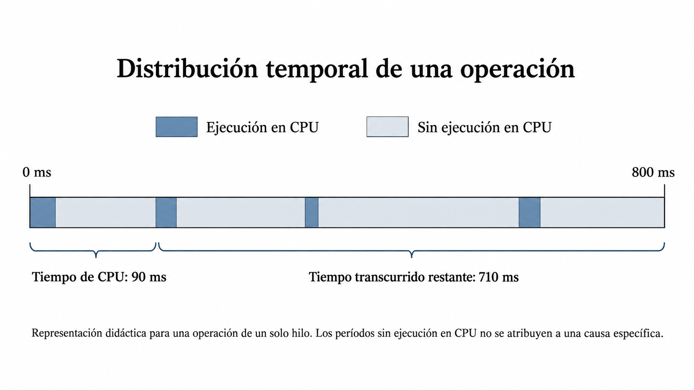
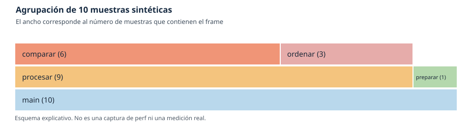
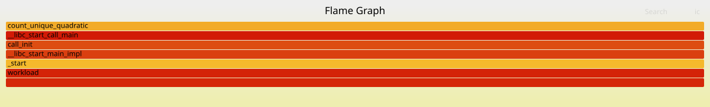

# 4.1. Profiling y evaluación experimental del rendimiento

La Unidad IV, **Diagnóstico y aprendizaje operacional**, integra los métodos de medición y las fuentes de evidencia estudiados a lo largo del curso para investigar problemas de rendimiento y fallas en sistemas de software. 

En las unidades anteriores se examinaron los mecanismos del entorno de ejecución Linux, las métricas de producto y servicio, y la instrumentación mediante logs, métricas y trazas. A partir de esos fundamentos, esta unidad aborda la evaluación experimental del rendimiento, el diagnóstico basado en hipótesis, la respuesta a incidentes y el análisis de sus causas y factores contribuyentes. El propósito es pasar de observar el comportamiento de un sistema a explicar los mecanismos que lo producen, contrastar posibles intervenciones y documentar lo aprendido a partir de la evidencia disponible.

El problema de partida es concreto: un programa procesa un conjunto de registros correctamente, pero su ejecución requiere más tiempo del esperado. La duración observada permite describir el síntoma, aunque no identifica qué parte del programa consume CPU ni proporciona una justificación suficiente para modificarlo. Se necesita primero una comparación reproducible y, después, evidencia sobre la distribución del trabajo realizado durante la ejecución.

**Objetivos de aprendizaje**

Al finalizar la sesión, el estudiante será capaz de:

- Definir una evaluación de rendimiento especificando la carga de trabajo, las magnitudes observadas y las condiciones de ejecución.
- Diseñar e interpretar un benchmark reproducible, considerando las repeticiones, la variabilidad y los factores que pueden afectar la comparación.
- Explicar el funcionamiento del profiling de CPU por muestreo y la información que proporcionan las pilas de llamadas.
- Interpretar informes de `perf` y flame graphs para identificar rutas de ejecución que concentran muestras de CPU, reconociendo las limitaciones de esa evidencia.
- Evaluar una modificación de código mediante la comprobación de equivalencia funcional y la comparación de mediciones obtenidas bajo condiciones controladas.

## 1. Fundamentos de evaluación del rendimiento

El **rendimiento** describe cómo responde un sistema a una carga de trabajo bajo condiciones definidas. El resultado depende de qué tarea se ejecuta, qué volumen y distribución tienen los datos, qué recursos están disponibles y qué otras actividades compiten por ellos. El tiempo de ejecución de un programa, por tanto, no es una propiedad constante del código fuente.

| Magnitud | Definición operacional | Unidad y alcance |
|---|---|---|
| **Tiempo transcurrido** (*elapsed* o *wall-clock*) | Intervalo entre dos instantes medidos por un reloj apropiado; incluye períodos de ejecución y períodos en los que la operación no progresa en CPU. | s o ms por operación |
| **Tiempo de CPU** | Suma del tiempo de ejecución en CPU atribuido a un hilo o proceso durante el intervalo considerado. | s de CPU; un proceso multihilo puede acumular más CPU que tiempo transcurrido |
| **Throughput** | Unidades de trabajo completadas por unidad de tiempo. | registros/s, solicitudes/s, etc.; debe definirse qué constituye una unidad completada |
| **Utilización** | Fracción de una capacidad de procesamiento efectivamente ocupada durante una ventana. | % respecto a un denominador explícito: un núcleo, varios vCPU o una cuota |

### Tiempo de ejecución y tiempo de espera

Supóngase una operación que tarda **800 ms** en completarse y acumula **90 ms de CPU**. La siguiente línea temporal es **didáctica**, no corresponde a una medición real. Representa una posible distribución del tiempo para una operación de un solo hilo; no pretende identificar los motivos exactos de cada espera.



*Figura 1. Distribución ilustrativa del tiempo de CPU en una operación de un solo hilo. Los segmentos representan intervalos de ejecución y de ausencia de ejecución en CPU. Las cifras expresan sus totales y no describen una medición real.*

En este caso, los **710 ms restantes no son necesariamente tiempo de disco o de red**. Pueden contener espera de una dependencia, bloqueo de sincronización, tiempo sin asignación de CPU u otras situaciones. Incluso distinguir «bloqueado» de «ejecutable, pero sin CPU» requiere información del planificador u otras señales. En una aplicación con varios hilos, restar tiempo de CPU agregado al tiempo transcurrido tampoco produce un «tiempo de espera» válido: ambas magnitudes tienen unidades temporales, pero no describen una partición equivalente del intervalo.

La selección de una técnica depende de la pregunta. Un benchmark indica cuánto tarda una carga. Un perfil de CPU investiga dónde se ejecutan instrucciones durante esa carga. Si el tiempo transcurrido es alto y la CPU acumulada es baja, un perfil *on-CPU* puede revelar poco sobre la espera dominante; convendría buscar evidencia de I/O, concurrencia, dependencias o planificación, como se estudiará en la clase 4.2.

### Condiciones que hacen interpretable una medición

Una afirmación como «el programa tardó dos segundos» es insuficiente sin especificar, al menos, el tamaño y características de la entrada, la operación medida, la versión del programa, el número de hilos, el entorno de ejecución y el instante de inicio y fin. En una VM también importan la asignación de vCPU, los límites de recursos y la actividad del anfitrión, que no siempre es observable desde el invitado.

En el caso que acompaña este capítulo se medirá el tiempo necesario para **contar valores distintos** en una colección determinista de enteros. El resultado funcional se verificará antes de comparar tiempos. La misma tarea se implementa mediante comparaciones sucesivas y mediante ordenamiento. La carga aislada facilita observar la relación entre algoritmo y consumo de CPU. Sus resultados no describen por sí mismos el comportamiento de un servicio en producción.

## 2. Benchmarking y reproducibilidad experimental

Un **benchmark** es un procedimiento definido para ejecutar una carga y obtener una o varias medidas de rendimiento bajo condiciones conocidas. Debe poder repetirse y sus resultados deben poder compararse. No se limita a la herramienta que mide el reloj: requiere especificar la carga, el entorno, las métricas y el tratamiento de la variabilidad.

### Diseño de la comparación

Para comparar dos implementaciones del conteo de valores distintos se utilizarán las mismas entradas y se verificará que ambas entregan el mismo resultado. Se conservarán la misma máquina virtual, las opciones de compilación y las condiciones que razonablemente puedan controlarse. Cuando no sea posible controlar una variable, como la actividad del hipervisor, esa limitación debe registrarse.

El programa adjunto distingue dos mecanismos de repetición que responden a necesidades diferentes:

* `REPETICIONES` ejecuta la operación varias veces **dentro de un proceso**, aumentando la duración útil para el perfil. El tiempo impreso comprende todas esas invocaciones, y **no** representa una muestra independiente por repetición.
* Ejecutar el binario varias veces produce **observaciones entre procesos**. Estas permiten examinar la dispersión entre ejecuciones, aunque tampoco garantizan independencia estadística completa.

La aplicación utiliza entradas deterministas y acumula en una variable `volatile` el resultado de **cada** invocación, impidiendo que el compilador descarte sin más las repeticiones como cálculos sin efecto observable. La escritura `volatile` agrega una operación auxiliar muy pequeña a cada repetición. No impide todas las optimizaciones ni garantiza identidad de instrucciones entre compiladores. Las funciones de cálculo están marcadas `noinline`, una extensión de GCC que facilita reconocerlas en perfiles; ambas decisiones se documentan como parte del experimento.

### Repetición y dispersión: ejemplo resuelto

Los valores siguientes son **datos didácticos inventados para analizar un diseño experimental**. No proceden de la VM del curso. Representan cinco ejecuciones de dos versiones sobre una misma carga, en milisegundos.

| Ejecución | Versión A (ms) | Versión B (ms) |
|---:|---:|---:|
| 1 | 126 | 104 |
| 2 | 131 | 106 |
| 3 | 128 | 103 |
| 4 | 190 | 105 |
| 5 | 129 | 144 |

Ordenando los valores de A se obtiene 126, 128, **129**, 131 y 190 ms; su mediana es **129 ms**. Para B, la secuencia ordenada es 103, 104, **105**, 106 y 144 ms; la mediana es **105 ms**. El rango de A es **64 ms** (190 − 126), mientras que el de B es **41 ms** (144 − 103). Ambas series contienen una observación que se aparta del resto. El rango depende únicamente de los extremos y, con cinco observaciones, no permite afirmar que B tenga menor variabilidad inherente. Nuevas ejecuciones podrían cambiar sustancialmente ambos rangos.

La comparación de medianas describe una reducción relativa del tiempo de **(129 − 105)/129 ≈ 18,6 %** para esta carga hipotética. No se puede atribuir con seguridad la diferencia a la implementación sin examinar el procedimiento experimental. Los valores extremos podrían deberse a interferencia de otras tareas, calentamiento o fenómenos específicos del entorno. Con cinco observaciones tampoco es razonable caracterizar la variabilidad general del sistema ni afirmar un intervalo de confianza preciso.

La mediana reduce la influencia de observaciones extremas, pero no «corrige» por sí sola errores sistemáticos de medición. Si todas las ejecuciones de A se realizan antes que las de B, un cambio progresivo del entorno podría confundirse con un efecto del código. Alternar el orden A/B ayuda a reducir ese riesgo. El registro de las mediciones individuales permite comprobar aspectos que se pierden al reportar únicamente una cifra resumen.

### Calentamiento, efectos de escala y microbenchmarks

Algunas ejecuciones iniciales pueden diferir de las posteriores por cachés, asignación de memoria o inicialización de bibliotecas. En lenguajes con compilación JIT también interviene la compilación dinámica. Un período de *warm-up* puede ayudar, pero su utilidad debe comprobarse: no existe un número universal de ejecuciones que garantice estabilidad. Si se excluyen mediciones iniciales, el criterio debe haberse establecido y documentado, no decidirse después de observar resultados desfavorables.

Un **microbenchmark** mide una operación pequeña y controlada. Facilita aislar diferencias, aunque puede no reproducir los patrones de entrada, concurrencia o acceso a memoria de un servicio real. Un algoritmo que mejora el tiempo de este ejercicio no ha demostrado por ello que reduzca el p95 de latencia de una API. Una medición puede ser técnicamente correcta y poco útil para decidir. Si la carga ensayada no representa el uso real, el cambio podría acelerar una operación aislada sin mejorar la latencia observada por los usuarios.

Un benchmark permite estimar la diferencia de tiempos entre versiones, pero no indica qué ruta de ejecución explica dicha diferencia. El perfil de CPU aporta evidencia complementaria sobre la distribución del trabajo. Esta transición exige conservar la misma carga e identificar con claridad el intervalo observado.

## 3. Profiling de CPU y análisis de pilas de ejecución

Un **perfil de CPU** describe la distribución de la actividad muestreada entre funciones o rutas de ejecución durante un intervalo. Su propósito es responder qué partes del código aparecen mientras se ejecuta trabajo en CPU. Un perfil no reconstruye automáticamente todas las llamadas realizadas ni la duración individual de cada invocación.

### Instrumentación y muestreo

El profiling puede utilizar instrumentación, que registra eventos seleccionados asociados a regiones de código, o **muestreo**, que observa periódicamente el punto de ejecución y, cuando es posible, su pila de llamadas. La instrumentación puede ofrecer medidas detalladas de regiones, aunque su sobrecarga puede aumentar con la frecuencia de eventos. El muestreo suele reducir el volumen de observaciones, a cambio de producir una estimación estadística de la actividad observada.

Considérese un programa con tres funciones: `main` invoca `procesar`, y esta invoca alternativamente `comparar` u `ordenar`. En diez instantes de muestreo se obtienen las siguientes pilas. Son **datos sintéticos** que sirven únicamente para entender el mecanismo.

| Pila de llamadas observada (de origen a función activa) | Número de muestras |
|---|---:|
| `main → procesar → comparar` | 6 |
| `main → procesar → ordenar` | 3 |
| `main → preparar` | 1 |
| **Total** | **10** |

De estas observaciones puede afirmarse que `comparar` estuvo en la parte activa de seis de las diez pilas, y `ordenar` en tres. `procesar` apareció en **nueve** de las diez, porque es ancestro de ambas rutas. Por ello es imprescindible distinguir:

- **Muestras exclusivas** de una función: observaciones donde esa función era el punto de ejecución, dentro de las limitaciones del muestreo.
- **Muestras inclusivas**: observaciones donde la función aparece en la pila, aunque la ejecución esté en una función descendiente.

La presencia inclusiva de `procesar` en el 90 % de las muestras **no significa** que el cuerpo de `procesar` ejecutó directamente el 90 % de las instrucciones. Tampoco puede inferirse que `comparar` fue invocada seis veces: una invocación larga podría aparecer en varias muestras, mientras que muchas invocaciones breves podrían pasar entre dos instantes de observación.

Una representación compacta de las frecuencias sintéticas es:

```text
Pila activa                         Muestras
main > procesar > comparar          ██████      6
main > procesar > ordenar           ███         3
main > preparar                     █           1
```

Esta figura **no es todavía un flame graph**. Muestra pilas completas agrupadas por frecuencia. El flame graph reorganiza el mismo tipo de datos por **frames y relaciones de ascendencia**, de forma que las rutas comunes comparten rectángulos.

### De las muestras al flame graph

En un flame graph convencional de CPU cada rectángulo representa un frame de pila. La profundidad se dispone verticalmente: las funciones ancestrales aparecen debajo de sus descendientes. La anchura de un frame es proporcional a las muestras que lo contienen, incluidas aquellas cuya función activa está en un descendiente. La posición horizontal **no es una línea temporal**; las pilas se reordenan para hacer visibles patrones agregados. Los colores tradicionales tampoco codifican, por sí solos, una gravedad o un coste particular. [Gregg, *Flame Graphs*](https://www.brendangregg.com/flamegraphs.html).

Con las diez muestras sintéticas, `main` ocupa el conjunto completo, `procesar` aparece en nueve, `comparar` en seis, `ordenar` en tres y `preparar` en una. Las proporciones de este ejemplo son exactas respecto a su **pequeña colección didáctica de muestras**, no estimaciones fiables del costo de una aplicación real. La figura `figuras/muestreo-flamegraph.svg` ilustra esta agrupación.



Un flame graph ancho puede representar una función costosa por llamada, una función barata invocada muchas veces, o una mezcla de ambas. El gráfico no contiene el número real de invocaciones. Si el programa pasa mucho tiempo bloqueado, un perfil *on-CPU* tampoco representa adecuadamente ese tiempo de espera. La investigación deberá recurrir a otras señales cuando la hipótesis así lo requiera.

### `perf stat`, `perf record` y `perf report`

En Linux, `perf` proporciona varios procedimientos con preguntas diferentes. `perf stat` obtiene contadores y estadísticas agregadas para un comando; `perf record` almacena muestras de eventos; `perf report` permite analizar los datos registrados. `perf record -g` intenta conservar pilas de llamadas, cuya reconstrucción depende del método elegido, los símbolos y las propiedades del binario. Para la demostración se compila con `-g -fno-omit-frame-pointer`. [Documentación oficial de `perf record`](https://github.com/torvalds/linux/blob/master/tools/perf/Documentation/perf-record.txt).

```bash
# Estadísticas del comando completo: no es un perfil de funciones.
perf stat -- ./workload quadratic 30000 3

# Muestreo de CPU y pilas con evento de software, si está disponible.
perf record -e cpu-clock -F 99 --call-graph fp -o perf-quadratic.data -- \
    ./workload quadratic 30000 20

# Informe de las muestras recogidas.
perf report --stdio -i perf-quadratic.data
```

El evento `cpu-clock` es una opción de muestreo basada en software que puede ser útil en entornos virtualizados cuando faltan contadores de hardware; **no elimina** restricciones de acceso, soporte o compatibilidad. La frecuencia solicitada de 99 muestras por segundo es un parámetro inicial, no una garantía de que se obtendrá exactamente ese número. Deben revisarse las muestras efectivamente registradas, posibles pérdidas y si las pilas resultan legibles. Si la ejecución dura apenas unos milisegundos, el perfil puede ser demasiado escaso para interpretarlo.

En `perf report`, el porcentaje de sobrecarga (*overhead*) se refiere a la fracción de muestras ponderadas o eventos registrados dentro del perfil seleccionado, no a un porcentaje universal del tiempo total de respuesta del servicio. La interpretación depende de si el informe muestra costo *self* o *children* y del evento utilizado. Una función con contribución inclusiva elevada puede ser ancestro de otra donde efectivamente se concentran las muestras.


### Interpretación de un informe de muestras

Supóngase que un perfil didáctico acumula **100 muestras del mismo evento, todas con el mismo peso**, y reconstruye correctamente sus pilas. Una vista simplificada de las columnas `Children` y `Self` podría mostrar:

| Símbolo | Children | Self | Interpretación |
|---|---:|---:|---|
| `main` | 100 % | 2 % | Casi todas las muestras contienen este ancestro, pero pocas terminan en él. |
| `procesar` | 90 % | 5 % | La mayor parte de la actividad muestreada pasa por sus descendientes. |
| `comparar` | 65 % | 65 % | Las muestras asociadas a esta ruta se concentran en su propia ejecución. |
| `ordenar` | 20 % | 20 % | También consume CPU, pero representa una fracción menor del evento muestreado. |
| `preparar` | 8 % | 8 % | Ejecuta trabajo fuera de `procesar`. |

**Los números son sintéticos y esquemáticos:** no son una transcripción real de `perf report`. El 5 % exclusivo de `procesar` junto con 65 % y 20 % de sus descendientes explica el 90 % inclusivo. Las contribuciones `Self` suman 100 %; las `Children` no deben sumarse como porcentajes de particiones independientes, pues una misma muestra aparece en varios ancestros. En datos reales, el cálculo del overhead también depende del período o peso de los eventos registrados, así como de las opciones de agrupación y visualización. Véase [`perf-report(1)`](https://man7.org/linux/man-pages/man1/perf-report.1.html).

Por ejemplo, si dos ejecuciones acumulan porcentajes similares en `comparar` pero una tarda 3 s y otra 9 s, los porcentajes no implican consumos absolutos iguales. Se necesitarán además los tiempos de cada ejecución o las cuentas de CPU correspondientes. Un porcentaje de muestras tampoco informa cuántas veces fue llamada una función.

### Perturbación de la medición

Registrar muestras y reconstruir pilas requiere recursos. Aumentar la frecuencia de muestreo puede mejorar el detalle del perfil, pero también incrementar la sobrecarga y el volumen de datos. Para observar este efecto puede ejecutarse el workload una vez sin profiling y otra bajo `perf record`, manteniendo carga y entorno. La diferencia de tiempos incluye **tanto la perturbación causada por la observación como la variación normal entre ejecuciones**: una sola pareja de mediciones no estima de forma fiable la sobrecarga. El procedimiento deberá repetirse antes de formular una conclusión cuantitativa.

### Generación del flame graph de la demostración

El repositorio de [Brendan Gregg, FlameGraph](https://github.com/brendangregg/FlameGraph) contiene los scripts `stackcollapse-perf.pl` y `flamegraph.pl`, que convierten la salida de `perf script` en un SVG. Para que la clase no dependa de descargas durante la sesión, los scripts deben instalarse o dejarse preparados **previamente en la VM oficial**. En el siguiente ejemplo se supone que el directorio `FlameGraph/` ya está disponible junto al programa:

```bash
perf script -i perf-quadratic.data > perf-quadratic.script
./FlameGraph/stackcollapse-perf.pl perf-quadratic.script > perf-quadratic.folded
./FlameGraph/flamegraph.pl perf-quadratic.folded > perf-quadratic.svg
```

Si los scripts no están presentes, la secuencia no debe ejecutarse como si fueran componentes incluidos en Linux. La lectura de un perfil preparado en el material del curso puede utilizarse como alternativa didáctica, dejando explícito que no constituye evidencia generada en esa ejecución.

### Perfil obtenido durante la preparación de la clase

La siguiente figura procede de una ejecución de `./workload quadratic 30000 30` con `perf record -e cpu-clock:u -F 99 --call-graph fp`. El registro informó de **163 muestras**, ninguna perdida, y un tiempo transcurrido interno de aproximadamente **1,651 s**. El perfil concentró todas las muestras registradas en `count_unique_quadratic`. Son resultados obtenidos durante la preparación del material y pueden variar al repetir el experimento.



*Figura 3. Flame graph de la implementación `quadratic`. La ruta dominante es simple: `count_unique_quadratic` recibe las muestras directas, mientras que sus ancestros aparecen en niveles inferiores de la pila. El ancho representa la proporción de eventos agregados, no una duración de reloj. El valor grande etiquetado como «samples» por la herramienta de generación corresponde al peso acumulado del evento, no a la cantidad de registros: `perf record` informó de 163 muestras.*


## 4. Evaluación comparativa de optimizaciones

Una ruta predominante en un perfil identifica **dónde conviene investigar**, pero no determina automáticamente qué modificación realizar ni cuánto mejorará el programa. La decisión requiere comprender el trabajo que ejecuta la función, plantear un cambio con una predicción verificable y medir nuevamente con condiciones comparables.

### Dos implementaciones de la misma operación

La demostración cuenta los valores distintos presentes en un arreglo de enteros. La implementación `quadratic` recorre los elementos anteriores para averiguar si cada valor ya apareció. En el peor caso realiza un número de comparaciones que crece de forma cuadrática con el tamaño de la entrada. La implementación `sorted` reserva memoria, copia el arreglo, ejecuta `qsort`, cuenta transiciones entre valores adyacentes y libera la memoria. **Todos esos costos pertenecen a la operación medida**; no se compara únicamente el costo de las comparaciones. Bajo las propiedades habituales de `qsort`, el enfoque se describe didácticamente por su comportamiento típico cercano a \(O(n\log n)\), **sin asumir una garantía universal de complejidad para todas las implementaciones de `qsort`**.

En la demostración se investiga **primero** `quadratic` sin mostrar los resultados de `sorted`: se construye una línea base, se registra un perfil y se propone una explicación de la ruta costosa. Solo después se presenta `sorted` como posible intervención. Las variantes realizan el mismo trabajo funcional observable, pero utilizan estrategias algorítmicas diferentes. La elección permite obtener rutas de CPU reconocibles. No se utilizará el resultado para demostrar una ley universal según la cual un algoritmo de una clase de complejidad siempre vence a otro para cualquier tamaño de entrada. Las constantes, las entradas y la implementación concreta siguen importando.

### Cálculo e interpretación de la mejora

Con tiempos resumen \(T_{\mathrm{base}}\) y \(T_{\mathrm{nuevo}}\), medidos bajo condiciones equivalentes, la reducción relativa es:

\[
R=\frac{T_{\mathrm{base}}-T_{\mathrm{nuevo}}}{T_{\mathrm{base}}}\times100\%.
\]

En el ejemplo didáctico de la sección 2, la reducción calculada con medianas fue 18,6 %. Esa cifra describe **solo ese conjunto sintético**. El informe real de la práctica deberá calcular el valor con las mediciones obtenidas en la VM; si los resultados varían demasiado o las condiciones no son comparables, es preferible declarar la evidencia inconclusa a presentar una precisión ficticia.

Una mejora de la operación local no implica necesariamente la misma mejora de un servicio. El tiempo de la función puede representar una fracción reducida del tiempo total, y al disminuir su costo otras rutas pasarán a ocupar una mayor proporción del perfil. El cambio de proporciones no significa por sí mismo que dichas rutas se hayan vuelto más lentas.

### Criterios de un informe experimental

El informe debe contener: pregunta y predicción; descripción de la entrada; equivalencia funcional; máquina, compilador y opciones; mediciones individuales; medidas resumen y dispersión; perfil e interpretación de sus rutas; modificación propuesta; medición posterior y límites de la conclusión. Conviene distinguir dos enunciados: «la versión B tuvo una mediana inferior en esta carga y estas ejecuciones» es una descripción de evidencia; «la versión B será más rápida en cualquier entorno» es una generalización que los datos no respaldan.

## Práctica guiada en la máquina virtual oficial

El archivo `workload.c` que acompaña la lectura no requiere red ni servicios externos para ejecutarse. `benchmark.sh` automatiza el registro alternado de mediciones entre procesos. Los comandos siguientes documentan un **procedimiento de validación**, no resultados ya obtenidos en la imagen oficial.

### 1. Comprobación del entorno

```bash
uname -r
cat /etc/os-release
command -v gcc
command -v perf
cat /proc/sys/kernel/perf_event_paranoid
perf list software
```

Que `perf` esté instalado no garantiza que pueda registrar muestras. Los permisos del kernel, las capacidades del proceso, las políticas de seguridad y la virtualización pueden restringir eventos. No se recomienda modificar globalmente `perf_event_paranoid` ni ejecutar el experimento con privilegios elevados como primera respuesta al error. Primero debe documentarse el mensaje y determinar si el problema corresponde a permisos o a falta de soporte. Véase la [documentación de seguridad de perf](https://www.kernel.org/doc/html/latest/admin-guide/perf-security.html).

### 2. Compilación y comprobación funcional

```bash
gcc -O2 -g -fno-omit-frame-pointer -Wall -Wextra -std=c11 \
    workload.c -o workload
./workload quadratic 3000 1
./workload sorted 3000 1
```

El campo `distintos` debe coincidir. Se compara después el mismo tamaño de entrada y el mismo objetivo funcional. El campo `elapsed_s` mide solamente el intervalo interno de operaciones; `perf stat` abarca el proceso observado por la herramienta. No deben confundirse ambas ventanas temporales.

### 3. Benchmark con ejecuciones separadas

La comparación comienza por la variante `quadratic` para localizar el trabajo dominante. Después se presenta la intervención `sorted` y se verifican los mismos resultados funcionales. La toma de tiempos se efectúa por rondas con orden alternado; el script `benchmark.sh` conserva cada observación en `resultados.csv` y registra el tiempo interno del programa.

```bash
chmod +x benchmark.sh
./benchmark.sh 30000 3 resultados.csv
cat resultados.csv
```

Cada fila representa un proceso distinto. `REPETICIONES=3` aumenta el trabajo dentro del proceso, pero no debe tratarse como tres observaciones independientes. La alternancia A/B y B/A reduce un posible sesgo por deriva del entorno, aunque no elimina toda interferencia. No se descartan observaciones atípicas sin investigar su procedencia.

### 4. Contadores y perfil

```bash
perf stat -- ./workload quadratic 30000 3
perf stat -- ./workload sorted 30000 3

# Ajustar REPETICIONES tras comprobar la duración y el número de muestras.
perf record -e cpu-clock -F 99 --call-graph fp -o perf-quadratic.data -- \
    ./workload quadratic 30000 20
perf report --stdio -i perf-quadratic.data
```

Las repeticiones 20 y 400 son **valores iniciales de preparación**, no configuraciones certificadas para la VM. Si el perfil contiene pocas muestras, deben calibrarse las repeticiones internas hasta obtener una ejecución del orden de segundos sin alterar el tamaño de entrada. Es incorrecto comparar tiempos totales de ejecuciones con números distintos de repeticiones como si correspondieran a una sola operación. Para registrar la variante rápida se puede comenzar con `./workload sorted 30000 400`, verificar el tiempo transcurrido y ajustar el parámetro. Conviene comprobar también si las pilas se recuperan y si `perf` informa de pérdida de muestras. Un perfil vacío o insuficiente debe identificarse como tal, nunca interpretarse como ausencia de hotspots.

### 5. Visualización de pilas y flame graph

```bash
perf script -i perf-quadratic.data > perf-quadratic.script
./FlameGraph/stackcollapse-perf.pl perf-quadratic.script > perf-quadratic.folded
./FlameGraph/flamegraph.pl perf-quadratic.folded > perf-quadratic.svg
```

La generación requiere los scripts de FlameGraph previamente instalados en la VM; no son parte de `perf`. Debe comprobarse que el informe contiene muestras y que las pilas recuperadas muestran funciones del programa antes de interpretar el SVG.

### 6. Comparación posterior y documentación

Se ejecutarán las mismas verificaciones y se registrarán los resultados de la variante `sorted`. Se contrastarán tiempos y perfiles, procurando no introducir cambios adicionales en el entorno. La interpretación debe explicar qué cambió en el trabajo realizado por las rutas principales, qué magnitud se midió y qué queda fuera del alcance experimental.

**Plan alternativo ante restricciones de la VM.** Si `perf stat` o `perf record` no funcionan, pueden conservarse las mediciones internas del programa, documentarse el error de acceso y utilizarse un perfil de referencia preparado con su procedencia identificada para ejercitar la lectura de pilas. Esto permite alcanzar parcialmente los resultados conceptuales, pero **no equivale a haber realizado profiling en esa VM**.

## Preguntas de comprobación

1. ¿Por qué la diferencia entre 800 ms transcurridos y 90 ms de CPU no identifica por sí sola un problema de I/O?
2. ¿Qué diferencia existe entre ejecutar una operación veinte veces dentro de un proceso y ejecutar veinte procesos independientes?
3. ¿Por qué `procesar` aparece en nueve de las diez muestras sintéticas si ninguna de esas muestras termina directamente en su cuerpo?
4. ¿Qué información sobre el tiempo cronológico no ofrece un flame graph convencional?
5. Si una función pasa de representar 70 % a 90 % de las muestras después de modificar otra función, ¿puede afirmarse que ahora tarda más? ¿Qué medición adicional ayudaría?
6. ¿Cuándo es improcedente aplicar un porcentaje de mejora obtenido en un microbenchmark a la latencia de un servicio?

## Referencias y lecturas

- Gregg, B. (2020). *Systems Performance: Enterprise and the Cloud*, 2.ª ed. Addison-Wesley.
- Linux `perf`: [`perf-stat(1)`](https://man7.org/linux/man-pages/man1/perf-stat.1.html), [`perf-record(1)`](https://man7.org/linux/man-pages/man1/perf-record.1.html), [`perf-script(1)`](https://man7.org/linux/man-pages/man1/perf-script.1.html).
- Linux Kernel. [*Perf events and tool security*](https://www.kernel.org/doc/html/latest/admin-guide/perf-security.html).
- Gregg, B. [*Flame Graphs*](https://www.brendangregg.com/flamegraphs.html) y [*CPU Flame Graphs*](https://www.brendangregg.com/FlameGraphs/cpuflamegraphs.html).
- Gregg, B. [Repositorio de scripts FlameGraph](https://github.com/brendangregg/FlameGraph).


