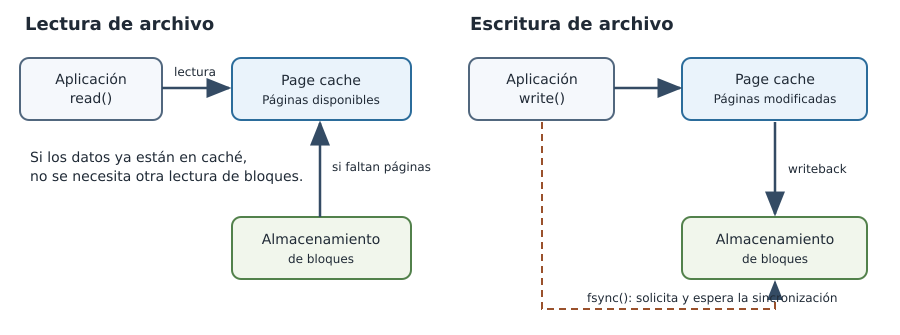

# 4.2 Latencia de I/O y análisis de esperas

El rendimiento de una aplicación no depende únicamente del trabajo que realiza la CPU. Cuando un programa accede a archivos, el tiempo transcurrido puede incluir movimientos de datos entre memoria y almacenamiento, solicitudes pendientes, actividad del kernel y períodos durante los cuales el hilo no ejecuta instrucciones. Cuando una operación tarda más de lo esperado, la causa no siempre está en el procesador o en el almacenamiento. Parte del tiempo puede corresponder a esperas por otros recursos.

Este capítulo explica cómo Linux atiende las lecturas y escrituras de archivos ordinarios, por qué la caché de páginas modifica los tiempos observables y qué significa solicitar la sincronización de los datos. A continuación, se emplean mediciones de aplicación, contadores por proceso y estadísticas de dispositivos para investigar esos mecanismos sobre un mismo archivo de prueba. El objetivo es interpretar la evidencia con precisión, sin atribuir automáticamente una diferencia temporal a una causa que no ha sido comprobada.

**Al finalizar el capítulo, se espera que el estudiante pueda:**

1. Distinguir el bloqueo de un hilo del modelo síncrono o asíncrono utilizado para solicitar I/O.
2. Explicar por qué la caché de páginas puede cambiar el costo de lecturas repetidas y por qué el retorno de `write()` no implica necesariamente persistencia.
3. Interpretar, según su alcance, tiempos de llamadas al sistema, contadores de I/O por proceso y estadísticas agregadas de dispositivos.
4. Ejecutar una comparación experimental controlada de lectura y escritura, e identificar observaciones compatibles con el uso de caché y con la sincronización explícita.
5. Formular conclusiones que separen mediciones, mecanismos plausibles y afirmaciones que requerirían evidencia adicional.

## 1. Modelo de ejecución de operaciones de I/O

### Tiempo transcurrido y tiempo de CPU

Un programa que procesa un archivo puede dedicar parte del tiempo a ejecutar instrucciones y otra parte a esperar que una operación produzca datos. Si se mide el intervalo entre el inicio y el final de una llamada, se obtiene **tiempo transcurrido**. Ese intervalo puede incluir trabajo del kernel, acceso a memoria, esperas, planificación y, según la operación, actividad del dispositivo de almacenamiento. No equivale necesariamente al tiempo de CPU empleado por el proceso.

Considérese una operación cuyo tiempo transcurrido es de 120 ms y cuyo hilo acumula 8 ms de CPU durante ese intervalo. Los 112 ms restantes no se pueden etiquetar automáticamente como "espera de disco". Parte de la diferencia puede corresponder a períodos sin ejecución por planificación, esperas sobre recursos compartidos u otros mecanismos. Se necesitaría observar las llamadas al sistema y la actividad del almacenamiento antes de atribuir el retraso a I/O de bloques. 

Una llamada a `read(fd, buffer, n)` solicita hasta `n` bytes de un descriptor. Para un archivo regular, la ruta de ejecución habitual puede obtener los datos de la caché de páginas; si no están disponibles, el kernel puede necesitar leerlos del almacenamiento subyacente. La llamada devuelve el número de bytes leídos o indica que ocurrió un error, pero no informa cuánto tiempo se dedicó a cada etapa de la operación.

### Bloqueo y modalidad de I/O

**Bloqueante** significa que una operación puede hacer que el hilo permanezca esperando hasta que exista una condición para continuar. Un hilo bloqueado no necesita consumir CPU continuamente mientras espera; otros hilos o procesos pueden ejecutarse. El kernel puede suspenderlo y reactivarlo cuando se cumpla la condición pertinente.

**No bloqueante** indica que determinadas operaciones pueden devolver inmediatamente un resultado que señale que todavía no pueden completarse, en lugar de esperar. Esto se observa claramente en sockets y pipes configurados con `O_NONBLOCK`. No debe trasladarse mecánicamente esa interpretación a los archivos regulares: en Linux, `O_NONBLOCK` normalmente no cambia el comportamiento de I/O de archivos ordinarios.

**Síncrono** y **asíncrono** describen otra dimensión: cómo se solicita y se obtiene la finalización de una operación. En una interfaz síncrona convencional, el código recibe el resultado en el retorno de la llamada correspondiente. Una interfaz asíncrona puede comunicar la finalización posteriormente, por ejemplo mediante un evento o una cola de completaciones. Que una interfaz permita lanzar una operación sin esperar su finalización no garantiza que toda la ruta interna sea no bloqueante.

| Dimensión | Pregunta | Ejemplo |
|---|---|---|
| Bloqueo | ¿Puede quedar esperando el hilo en esta operación? | Un `read()` que espera datos disponibles |
| Sin bloqueo | ¿Puede la operación devolver inmediatamente que aún no está lista? | Un `recv()` no bloqueante que retorna `EAGAIN` |
| Finalización síncrona | ¿Cuándo recibe el programa el resultado? | `read()` devuelve bytes o un error |
| Finalización asíncrona | ¿Cómo conoce el programa un resultado posterior? | Notificación de una operación de I/O solicitada antes |


## 2. Caché de páginas y escritura diferida

### Lecturas desde la caché y desde el almacenamiento



*Figura 1. Modelo conceptual de I/O de archivos ordinarios. La lectura puede resolverse desde la caché de páginas o requerir datos del almacenamiento. La escritura puede modificar páginas en memoria antes de que se complete su sincronización. Las flechas representan posibilidades, no una secuencia temporal obligatoria ni un esquema exhaustivo del kernel.*

Linux utiliza memoria RAM para conservar páginas de archivos que pueden volver a necesitarse. En una lectura ordinaria, si las páginas solicitadas ya se encuentran en la **page cache**, el kernel puede atender la solicitud sin emitir una nueva lectura física para esos datos. Si no están disponibles, puede requerirse I/O al dispositivo, aunque también pueden intervenir cachés y optimizaciones en otras capas, incluidas las del hipervisor.

No existe una equivalencia universal entre "primera lectura" y "lectura desde disco". Un archivo puede haberse leído previamente, puede caber en la memoria disponible o puede permanecer en cachés inferiores a las observadas dentro de la VM. Por ello, una única medición de tiempo no constituye prueba de que se haya efectuado un acceso físico.

El experimento propuesto más adelante incorpora `posix_fadvise(..., POSIX_FADV_DONTNEED)` para solicitar al kernel que descarte páginas asociadas con un archivo que no se esperan utilizar pronto. La llamada **intenta** liberar páginas de caché, pero no promete que todas sean expulsadas. Además, las páginas modificadas pendientes de escritura pueden no liberarse. Es una solicitud limitada al archivo, no un vaciado global de la caché. Véase la [página de manual de `posix_fadvise`](https://man7.org/linux/man-pages/man2/posix_fadvise.2.html).

### Escritura diferida y sincronización

Para archivos ordinarios abiertos sin modos especiales de sincronización, `write()` puede copiar datos hacia páginas en memoria y regresar antes de que todos los cambios hayan llegado al almacenamiento persistente. Esta modalidad se conoce como escritura almacenada temporalmente en caché (*buffered I/O*). Las páginas modificadas, llamadas *dirty pages*, pueden escribirse posteriormente mediante procesos de *writeback*.

`fsync(fd)` solicita sincronizar los datos y metadatos pertinentes del archivo con el almacenamiento. La llamada espera hasta que el dispositivo informe la finalización del trabajo de sincronización. No garantiza por sí sola que la entrada del archivo en el directorio también sea durable después de un corte de energía; esto puede exigir sincronizar el directorio. Véase [`fsync(2)`](https://man7.org/linux/man-pages/man2/fsync.2.html).

Por lo tanto, son momentos distintos:

1. El programa entrega datos a `write()` y la llamada retorna.
2. Las modificaciones pueden seguir pendientes de escritura física.
3. Una solicitud posterior de `fsync()` puede esperar trabajo de sincronización que aún no se ha completado.

Si una ejecución hipotética muestra `write_ms = 4` y `fsync_ms = 12`, no debe afirmarse que el dispositivo tardó exactamente 12 ms en escribir los datos. El segundo tiempo incluye lo que la llamada debió esperar para satisfacer su contrato de sincronización, bajo las condiciones de esa ejecución. En otra ejecución, parte del trabajo puede haberse realizado antes de que `fsync()` comenzara.

Al ejecutar el experimento en una máquina virtual, la escritura de los datos también depende del sistema anfitrión y de cómo esté configurado su almacenamiento. Por eso, aunque fsync() termine correctamente, no podemos asegurar que los datos hayan llegado a un medio físico persistente. El experimento permite estudiar el comportamiento de las operaciones de I/O desde Linux, pero no comprobar directamente cómo se almacenan los datos en el equipo anfitrión.

## 3. Medición de latencia de I/O en Linux

### Fuentes de evidencia y alcance

Una medición de aplicación responde cuánto tardó una operación desde sus propios límites. Una traza de syscalls permite examinar cuánto tiempo permaneció una llamada en ejecución. Un contador por proceso registra volumen de actividad atribuida. Las estadísticas por dispositivo agregan numerosas operaciones, posiblemente de diferentes procesos. Combinar esas fuentes resulta útil siempre que no se confundan sus alcances.

| Fuente | Qué se obtiene | Qué no demuestra por sí sola |
|---|---|---|
| Tiempo medido en el programa | Duración del tramo instrumentado, en ms | Qué componente explica toda esa duración |
| `strace -T` | Tiempo transcurrido de llamadas al sistema | Latencia física aislada del almacenamiento |
| `/proc/<PID>/io` | Bytes y operaciones contabilizados para el proceso | Latencia individual de cada lectura o escritura |
| `iostat -x` | Tasas y tiempos medios de operaciones de dispositivos | Tiempo de una solicitud particular de la aplicación |
| `/proc/diskstats` | Contadores acumulados de dispositivos de bloques | Causalidad o atribución por proceso sin más contexto |


### Estadísticas de dispositivo

En `iostat -x`, `r/s` y `w/s` representan tasas de operaciones; `rkB/s` y `wkB/s` describen volúmenes por segundo; `r_await` y `w_await` muestran duraciones medias de operaciones contabilizadas por el dispositivo, que incluyen componentes de cola y servicio. Los nombres exactos dependen de la versión de `sysstat`.

La cifra `%util` indica la fracción del intervalo durante la cual el dispositivo registró actividad de I/O en la definición del contador correspondiente. En dispositivos que ejecutan operaciones simultáneamente, no equivale a un porcentaje lineal de capacidad utilizada. La documentación de [iostat](https://github.com/sysstat/sysstat/blob/master/man/iostat.in) advierte sobre esta interpretación.

En una VM, la actividad observada puede corresponder a un dispositivo virtual. No debe confundirse con la medida directa del disco físico del anfitrión. Además, las mediciones agregadas pueden incluir procesos ajenos al experimento.

### Cómo razonar a partir de varias señales

Considérese una lectura que devuelve 64 MiB y cuyo contador `read_bytes` no cambia. La interpretación razonable es que la lectura no requirió I/O de almacenamiento atribuido a ese proceso durante esa medición. Una explicación plausible es que los datos estaban disponibles en caché. No se ha probado con ese único contador la ubicación exacta de cada byte en todas las capas de memoria.

Si una segunda lectura presenta una duración menor, ese resultado refuerza la posibilidad de reutilización de datos, pero el efecto temporal también depende de CPU, planificación, readahead, estado de la VM y cachés del anfitrión. El razonamiento combina la duración y los contadores, sin tratar una sola medida como prueba concluyente.

En el estudio experimental siguiente se obtendrán esas mediciones y se evaluará cuándo la evidencia es compatible con los mecanismos descritos y cuándo permanece insuficiente.

---

## 4. Investigación experimental: lecturas, caché y sincronización de archivos

**Problema de investigación.** Una aplicación procesa varias veces el mismo archivo y registra duraciones diferentes. Se desea determinar qué mediciones son compatibles con la reutilización de páginas en memoria y cómo cambia el comportamiento observable cuando el programa solicita expresamente sincronizar una escritura.

La investigación consta de dos comparaciones relacionadas. En la primera se examinan lecturas del mismo contenido dentro de un proceso. En la segunda se comparan escrituras del mismo tamaño con y sin una llamada a `fsync()`. La evidencia de un experimento no debe utilizarse para atribuir el resultado del otro a un mecanismo particular sin comprobarlo.

En la investigación experimental se comparan lecturas sucesivas de un mismo archivo y escrituras con y sin `fsync()`. El objetivo no es obtener los menores tiempos, sino reconocer qué significan las mediciones y qué mecanismos pueden explicar las diferencias. **Las duraciones no están predeterminadas**: el caché, el planificador, el sistema de archivos y el hipervisor pueden modificar los resultados.

Los archivos se crearán exclusivamente en un directorio de trabajo. No se utilizará `drop_caches`, no se modificarán dispositivos de bloques y no se forzarán cargas intensivas sobre el almacenamiento.

### 4.1. Preparación del entorno y transferencia del código a Ubuntu Server

El programa de experimentación se distribuye como un archivo fuente en C: [descargar `io_lab.c`](recursos/io_lab.c). **El archivo debe descargarse primero en el equipo anfitrión y transferirse a la máquina virtual mediante `scp`.


**En el equipo anfitrión (Linux o macOS, o PowerShell con OpenSSH):** descargue `io_lab.c` desde el enlace anterior, abra la terminal en la carpeta que contiene el archivo y confirme su presencia:

```bash
ls -l io_lab.c
```

En PowerShell, el comando equivalente es `Get-Item .\io_lab.c`. 

Transfiera el archivo desde el **anfitrión**:

```bash
scp io_lab.c student@127.0.0.1
```


Si la configuración de VirtualBox utiliza redirección del puerto TCP 2222 del anfitrión al puerto SSH 22 de la VM, el comando sería, **solo cuando esa redirección exista**:

```bash
scp -P 2222 io_lab.c student@127.0.0.1:~/
```

La opción `-P` mayúscula establece el puerto SSH remoto para `scp`. 

**De nuevo en Ubuntu Server (VM):** coloque el archivo recibido en el directorio de trabajo y compruebe su existencia:

```bash
mkdir -p ~/io-clase-4-2
mv ~/io_lab.c ~/io-clase-4-2/
cd ~/io-clase-4-2
ls -l io_lab.c
```

`mkdir -p` crea el directorio cuando es necesario; `mv` traslada el archivo recibido; `cd` establece el directorio de la práctica, y `ls` verifica que el código fuente está disponible. Si `ls` no muestra el archivo, debe resolverse la transferencia antes de intentar compilar. **Los comandos restantes de esta investigación se ejecutan dentro de Ubuntu Server.**

```bash
uname -r
findmnt -T . -o TARGET,SOURCE,FSTYPE
df -h .
command -v gcc
command -v strace
command -v iostat
```

`uname -r` identifica el kernel; `findmnt -T .` muestra el sistema de archivos que contiene el directorio actual; `df -h .` informa el espacio disponible; `command -v` comprueba dónde se encuentran las herramientas. Si `FSTYPE` es `tmpfs`, cambie a un directorio ubicado sobre un sistema de archivos respaldado por el almacenamiento de la VM: medir `tmpfs` no permite investigar un dispositivo de bloques. Si alguna herramienta no está disponible, registre la ausencia y utilice el entorno Ubuntu preparado con esos paquetes. La ejecución de los experimentos no requiere privilegios administrativos.

Compile:

```bash
gcc -O2 -g -Wall -Wextra -Wpedantic -std=c11 io_lab.c -o io_lab
```

`-O2` aplica optimizaciones habituales, `-g` conserva información de depuración, `-Wall -Wextra -Wpedantic` habilita diagnósticos de compilación y `-o` establece el nombre del ejecutable. **La compilación debe terminar sin errores.** Si aparece una advertencia, examine su causa antes de interpretar los resultados.

Compruebe el espacio disponible: la práctica utiliza un archivo de 64 MiB y dos archivos de escritura de 32 MiB, por lo que se recomienda un margen superior a 150 MiB. Si el espacio es insuficiente, utilice 16 MiB para lectura y 8 MiB para escrituras; mantenga el mismo tamaño entre repeticiones que compare.

Prepare los datos:

```bash
mkdir -p datos
./io_lab prepare datos/entrada.bin 64
ls -lh datos/entrada.bin
```

El programa crea un archivo regular de 64 MiB con contenido determinista y solicita `fsync()` al terminar la preparación. Esta etapa **no es una medición del experimento**. `ls` debe mostrar aproximadamente 64 MiB. El archivo puede permanecer en caché después de crearse.

**Evidencia de referencia:** registre la versión del kernel, el tipo de sistema de archivos, el espacio disponible y el tamaño del archivo. Estos datos permiten contextualizar las mediciones posteriores.

### 4.2. Lecturas sucesivas y caché de páginas

Ejecute:

```bash
./io_lab read datos/entrada.bin 3 advise | tee lecturas.txt
```

`read` selecciona el modo de lectura; `3` solicita tres rondas dentro de un mismo proceso; `advise` invoca `POSIX_FADV_DONTNEED` antes de la primera; `tee` conserva la salida en `lecturas.txt` mientras la muestra. Cada ronda vuelve al inicio del archivo, lee su contenido y publica un resumen. Se registra el número de bytes obtenidos, una suma de comprobación y diferencias de contadores. La suma de comprobación ayuda a reconocer una lectura inconsistente, pero no sustituye una verificación criptográfica del archivo.

El siguiente fragmento muestra un **ejemplo ficticio del formato**:

```text
archivo=datos/entrada.bin tamano_bytes=67108864 rondas=3 fadvise=DONTNEED antes de primera ronda
aviso_DONTNEED=aceptado (no garantiza expulsion de cache)
fase=lectura_1 elapsed_ms=24.0 rchar_delta=67108960 read_bytes_delta=67108864 ...
bytes_leidos=67108864 checksum=VALOR_COMPROBACION
fase=lectura_2 elapsed_ms=8.0 rchar_delta=67108960 read_bytes_delta=0 ...
bytes_leidos=67108864 checksum=VALOR_COMPROBACION
```


Interpretación de campos:

| Campo | Significado |
|---|---|
| `elapsed_ms` | Duración transcurrida del bucle de lectura, en milisegundos |
| `bytes_leidos` | Bytes obtenidos por el programa durante esa ronda |
| `rchar_delta` | Cambio de bytes devueltos por operaciones de lectura del proceso; incluye trabajo auxiliar asociado a la obtención de estadísticas y no debe confundirse con `read_bytes_delta` |
| `read_bytes_delta` | Cambio de bytes de lectura contabilizados hacia almacenamiento para el proceso |
| `checksum` | Valor de comprobación obtenido a partir del contenido leído, no una medición de rendimiento |

Compare las tres rondas. Si `read_bytes_delta` es mayor en la primera y disminuye en las siguientes, el resultado es compatible con reutilización de páginas en caché. Si las duraciones son casi iguales o el contador permanece en cero, **no es automáticamente un error**: la indicación `DONTNEED` no obliga al kernel a expulsar páginas y la VM puede tener cachés adicionales.

Repita el experimento sin la indicación:

```bash
./io_lab read datos/entrada.bin 3 | tee lecturas-sin-aviso.txt
```

No presente esto como comparación controlada de dos estados idénticos de caché: el primer experimento ya modificó el estado del sistema. El segundo sirve para observar lecturas repetidas cuando no se pide explícitamente una liberación previa.

**Registro de lecturas:** complete la tabla con las mediciones obtenidas:

| Prueba | Ronda | `elapsed_ms` | `read_bytes_delta` | `checksum` |
|---|---:|---:|---:|---:|
| Con `advise` | 1 | | | |
| Con `advise` | 2 | | | |
| Con `advise` | 3 | | | |
| Sin `advise` | 1 | | | |
| Sin `advise` | 2 | | | |
| Sin `advise` | 3 | | | |

**Análisis de las lecturas.** Antes de formular una explicación, compare `bytes_leidos` y `read_bytes_delta` en cada ronda. ¿En cuáles se transfirieron bytes hacia el programa? ¿En cuáles se contabilizó I/O hacia el almacenamiento? A partir de esa comparación, explique qué observaciones son compatibles con la caché de páginas y qué no permiten asegurar acerca del dispositivo físico. 

### 4.3. Escritura diferida y `fsync()`

Ejecute primero una escritura con sincronización:

```bash
./io_lab write datos 32 sync | tee escritura-sync.txt
```

El programa abre `datos/escritura-sync.bin`, escribe 32 MiB y llama a `fsync()` antes de cerrar el archivo. Publica tres duraciones: `write_ms`, tiempo del conjunto de llamadas a `write`; `fsync_ms`, tiempo de la solicitud de sincronización; y `total_ms`, suma del intervalo de escritura y sincronización observado por el programa.

Después ejecute una escritura sin sincronización explícita, usando otro archivo de salida:

```bash
./io_lab write datos 32 nosync | tee escritura-sin-sync.txt
```

Este comando genera otro archivo de 32 MiB, pero no invoca `fsync()` de manera explícita. **No presupone que el contenido sea durable al finalizar**. La escritura puede activar actividad posterior del kernel.

Una salida didáctica de una ejecución con sincronización podría tener esta forma:

```text
archivo=datos/escritura-sync.bin tamano_MiB=32 fsync=si write_ms=9.4 fsync_ms=15.8 total_ms=25.2
fase=escritura elapsed_ms=25.2 ... write_bytes_delta=33554432
```

En otra máquina, `fsync_ms` puede ser muy pequeño. El dispositivo virtual, su caché y otras actividades afectan los resultados. Tampoco es obligatorio que `total_ms` de `sync` resulte mayor que el de `nosync` en una única comparación de pruebas.

La comparación mantiene el tamaño y el patrón de datos, pero no garantiza que las condiciones del almacenamiento sean idénticas entre ejecuciones. Por ejemplo, el kernel puede haber efectuado writeback de otra operación entre ambas pruebas. Por ello, el análisis debe centrarse en la diferencia semántica entre las llamadas y solo después en las duraciones observadas.

**Registro de escrituras:**

| Modo | `write_ms` | `fsync_ms` | `total_ms` | `write_bytes_delta` |
|---|---:|---:|---:|---:|
| `sync` | | | | |
| `nosync` | | | | |

Explique: ¿qué garantía adicional solicita el programa al invocar `fsync()`? ¿Por qué `write_bytes_delta` no constituye por sí solo un comprobante de persistencia física? ¿Por qué un tiempo reducido de `fsync()` no invalida su significado?

**Precaución:** `nosync` significa que este programa no llamó explícitamente a `fsync()`; no significa que el kernel tenga prohibido enviar datos al almacenamiento durante o después de la ejecución.

### 4.4. Correlación de llamadas y dispositivos

### Duración de llamadas al sistema

Para inspeccionar llamadas relacionadas con la escritura:

```bash
strace -T -o llamadas.txt -e trace=write,fsync,close \
  ./io_lab write datos 8 sync
```

`-T` muestra el tiempo transcurrido dentro de cada llamada trazada, en segundos; `-o llamadas.txt` guarda la traza; `-e trace=...` reduce las llamadas mostradas. El programa escribe solo 8 MiB para limitar el volumen de salida. Se utiliza un tamaño distinto del experimento anterior; por tanto, no se deben comparar directamente sus tiempos. No compare la duración de esta ejecución con la ejecución anterior como si solo hubiese cambiado la sincronización: `strace` también modifica el comportamiento observado.

```bash
grep -E 'write\(|fsync\(' llamadas.txt | tail -n 12
```

Localice una línea `fsync(...) = 0 <...>` y explique qué significa el cero de retorno y qué representa la cifra entre <>, expresada en **segundos**. Por ejemplo, `<0.012345>` indicaría aproximadamente 12.345 ms de tiempo transcurrido dentro de esa llamada (valor ilustrativo). **Ese intervalo no es una medición aislada de latencia física del dispositivo**. Si no aparece `fsync`, compruebe que se utilizó el modo `sync`.

### Estadísticas del dispositivo

En una segunda terminal, desde el mismo directorio, ejecute:

```bash
iostat -dx -y 1 5
```

`-d` muestra dispositivos, `-x` habilita métricas ampliadas, `-y` omite el primer informe acumulado desde el arranque, y `1 5` solicita cinco informes espaciados un segundo. Mientras `iostat` ejecuta, repita una escritura en la primera terminal, procurando iniciar la operación durante los intervalos observados:

```bash
./io_lab write datos 32 sync
```

Localice el dispositivo que contiene el sistema de archivos de trabajo, utilizando `findmnt -T .`. En sistemas con LVM o capas virtuales puede no existir una correspondencia uno a uno fácil de establecer. Observe tasas (`r/s`, `w/s`) y tiempos medios (`r_await`, `w_await` o `await`, según la versión). Si no se observa un aumento evidente, no atribuya el resultado a una falla ni concluya que no hubo escritura: el experimento puede haber durado menos que la ventana de observación, la actividad puede estar en otra capa o puede mezclarse con la de otros procesos.

**Registro de dispositivos:** anote el dispositivo observado, al menos una métrica con su unidad y por qué no describe exclusivamente el tiempo de una llamada de `io_lab`.

### 4.5. Integración de la evidencia y limpieza

Redacte una síntesis técnica que responda conjuntamente:

1. ¿Qué diferencias se observaron entre las lecturas y qué evidencia las relaciona con el almacenamiento o la caché?
2. ¿Qué informa `fsync()` que no informa solamente el retorno de `write()`?
3. ¿Qué aporta `strace -T` y qué aporta `iostat`? ¿Por qué no pueden sustituirse?


Los archivos creados se encuentran únicamente en `~/io-clase-4-2/datos`. Después de conservar los registros, si se desea liberar espacio:

```bash
rm -f datos/entrada.bin datos/escritura-sync.bin datos/escritura-sin-sync.bin
```

### 4.6. Dificultades frecuentes y comprobaciones

| Síntoma | Comprobación y tratamiento |
|---|---|
| `io_lab.c: No such file` | Comprobar que `scp` se ejecutó en el anfitrión, que el usuario y la IP corresponden a la VM, y ejecutar `pwd` y `ls -l` en Ubuntu Server |
| `scp: Connection refused` o timeout | Verificar que la VM esté encendida, que SSH esté activo y que el anfitrión pueda alcanzar su IP o el puerto reenviado; no confundir una IP del anfitrión con la de la VM |
| `Permission denied` al usar `scp` | Revisar usuario, método de autenticación y permisos de escritura del directorio remoto; no usar `sudo scp` como solución automática |
| `gcc: command not found` | Utilizar la VM preparada con GCC; no improvisar una instalación durante la práctica |
| `No space left on device` | Comprobar `df -h .`, eliminar solo archivos del experimento y utilizar tamaños reducidos |
| Todas las lecturas tienen `read_bytes_delta=0` | Es posible que los datos permanezcan en caché; documentar esa limitación, no vaciar las cachés globales |
| El tiempo de `fsync()` es muy pequeño | Puede haber adelantamiento del writeback o caché del almacenamiento virtual; registrar el hecho sin inventar causas |
| `iostat` no existe | Falta `sysstat`: continuar con los contadores por proceso y dejar registrada la limitación |
| `iostat` muestra poca actividad | La ventana de medición puede no coincidir con el trabajo; documentar el intervalo y repetir una vez si procede |
| `strace` registra llamadas adicionales | Es esperable: el proceso y la biblioteca estándar también realizan trabajo auxiliar |

## Referencias

- Kerrisk, M. *The Linux Programming Interface*. No Starch Press, 2010.
- Gregg, B. *Systems Performance: Enterprise and the Cloud*. 2.ª ed., Addison-Wesley, 2020.
- Linux man-pages: [`read(2)`](https://man7.org/linux/man-pages/man2/read.2.html), [`write(2)`](https://man7.org/linux/man-pages/man2/write.2.html), [`fsync(2)`](https://man7.org/linux/man-pages/man2/fsync.2.html), [`posix_fadvise(2)`](https://man7.org/linux/man-pages/man2/posix_fadvise.2.html), [`proc_pid_io(5)`](https://man7.org/linux/man-pages/man5/proc_pid_io.5.html).
- sysstat. [Documentación de `iostat`](https://github.com/sysstat/sysstat/blob/master/man/iostat.in).
